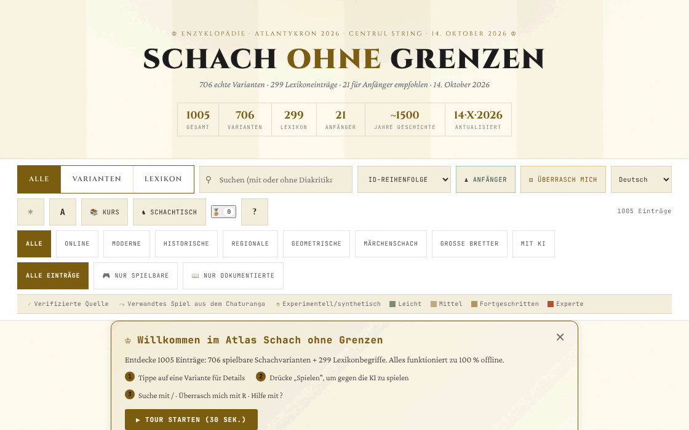

# Șah fără frontiere

[English](README.md) · [Română](README.ro.md) · [Français](README.fr.md) · [Italiano](README.it.md) · [Español](README.es.md) · [Português](README.pt.md) · **Deutsch** · [Magyar](README.hu.md)

**Version:** 14.6.1 · **Zuletzt aktualisiert:** 2026-10-19

Oberflächensprachen: **Română, English, Français, Italiano, Español, Português (PT), Deutsch, Magyar**

Atlas/Enzyklopädie von Schachvarianten: 706 Varianten und 299 Lexikoneinträge, mit spielbaren Engines für einen Teil davon.

**Online-App:** https://chiuta.github.io/Sah-fara-frontiere/

## Was es ist

Șah fără frontiere („Schach ohne Grenzen“) ist ein Atlas in einer einzigen HTML-Datei (v14.4.0, aktualisiert am 14. Oktober 2026; für den Workshop Atlantykron 2026 erstellt) mit 1005 Einträgen: 706 Schachvarianten (Online, modern, historisch, regional, geometrisch, Märchenschach, auf großen Brettern, mit KI) und 299 Lexikonbegriffe (Geschichte, KI, Spieler, Eröffnungen). Laut dem Abschnitt „Über diesen Atlas“ wird die Datei aus einem Python-Skript und einer JSON-Datendatei erzeugt, ohne Laufzeitabhängigkeiten, mit Umsetzung in KI-gestützten Iterationen.

## Funktionen

- Suche und Filter: Alle / Varianten / Lexikon; Kategorien (Online, Modern, Historisch, Regional, Geometrisch, Märchenschach, Große Bretter, Mit KI); „Alle Einträge“, „Nur spielbare“, „Nur dokumentierte“; Quellenmarkierungen (verifizierte Quelle, verwandtes Spiel aus dem Chaturanga, experimentell/synthetisch) und Schwierigkeitsstufen.
- Kuratierte Sammlungen: „Variante des Tages“ (deterministisch gewählt), „Grundlagen“, „Exotisch“, „Neue Geometrien“.
- Schaltflächen „Anfänger“ und „Überrasch mich“ (zufällige Variante).
- Ein Blatt für jeden Eintrag, mit „▶ Spielen“ für Varianten mit Engine: interaktives Brett, „Regeln: ON“, „KI“ und „KI gegen KI“, „Rückgängig“, „Zurücksetzen“, „Schritt“, „Drehen“, Ton, Notation (CJK / WXF), Vollbild, „PGN“- und „FEN“-Export; lokale ELO-Rangliste.
- „Kurs“: ein geführter 7-Tage-Pfad und 17 freischaltbare Errungenschaften (Abzeichen).
- „CSV exportieren (alle Einträge)“ und „Als BibTeX zitieren“; Schaltfläche „Link“ zum Teilen.
- Dunkles/helles Thema, drei Textgrößen, Zoom.
- „Fortschrittssicherung“ (unter „Über diesen Atlas“): exportiert und importiert in eine JSON-Datei den Kurs, die Abzeichen, das ELO und die lokalen Einstellungen (die `sff:`-Schlüssel); beim Import wird die Datei validiert und eine Bestätigung verlangt.

## Neue Funktionen (14.4.0) — „Schachtisch“

Sie öffnen sich über die Schaltfläche „Schachtisch“ neben „Kurs“ in einem Dialog mit fünf Tabs. **Geltungsbereich:** Alle neuen Funktionen beziehen sich auf **Standardschach** (FIDE-Regeln, eigene Engine, per Perft validiert); die 706 Varianten des Atlas sind nicht abgedeckt (sie behalten ihren Modus „▶ Spielen“ unverändert).

- **Zwei-Personen-Spiel über FFF.p2p** — zwei Personen, WebRTC direkt zwischen Browsern, **ohne Server**: Man tauscht manuell zwei Codes aus (Kopieren/Einfügen oder QR-Code), dann läuft das Spiel im „Lockstep“: Der Gastgeber (Weiß) validiert und nummeriert jeden Zug, der Gast (Schwarz) wendet ihn nach dem Echo des Gastgebers an; bei Abweichung wird der vollständige Zustand erneut gesendet. Remis und neues Spiel per Angebot mit Annahme/Ablehnung, Aufgabe, PGN-Export, Senden der Partie an den Analysator. **Einschränkungen:** keine Schachuhr; keine Zugrücknahme; kein Chat; die Partie wird nach dem Neuladen der Seite nicht fortgesetzt; die Gegner sehen gegenseitig ihre IP-Adresse; symmetrische NATs (Mobil-/Firmennetze) erfordern STUN/TURN, das optional hinzugefügt werden kann (standardmäßig leer) — dann gelangt die öffentliche IP an diesen Server.
- **Lokaler Analysator** — „Stellung analysieren“ (Bewertung in Bauern, bester Zug, Rangliste der besten Züge, erzwungenes Matt wird ausdrücklich angekündigt, wenn es gefunden wird) und „Partie analysieren“ (markiert die Züge, die deutlich schwächer sind als der beste). Du kannst FEN und PGN laden/exportieren. Alpha-Beta-Suche mit fester Tiefe (deterministisch, nicht uhrabhängig); es ist **keine** Turnier-Engine (nicht Stockfish), und die Bewertung ist näherungsweise.
- **Aufgabe des Tages** — eine Aufgabe „erzwungenes Matt in 1 oder 2“, **deterministisch aus dem Datum** erzeugt (für alle am selben Tag dieselbe, ohne Netzwerk); die Engine prüft, dass es genau einen gewinnenden ersten Zug gibt. Falscher Zug: Meldung mit dem Grund und, bei Matt in 2, der Verteidigung des Gegners. Serie gelöster Tage (lokal). Findet die Erzeugung keine Stellung, verwendet die Anwendung eine feste Ersatzaufgabe und sagt es.
- **„Warum kann ich nicht ziehen?“** — Du berührst eine Figur oder ein Feld, und die Anwendung erklärt in Worten: leeres Feld, gegnerische Figur, Figurengeometrie, blockierter Weg, der eigene König bliebe im Schach, Rochade nicht erlaubt (König gezogen, Turm gezogen, angegriffenes Feld, Figuren dazwischen), En passant, Umwandlung usw.; Schaltfläche und Taste `W`.
- **Tastatur und Audioansagen** — Brett mit 64 beschrifteten Schaltflächen, Pfeile + Enter, Befehlsfeld (SAN oder Koordinaten, z. B. `Nf3`, `e2e4`), Tasten `L` (letzter Zug), `S` (Status), `M` (Figuren, die ziehen können), `W` (warum ich nicht ziehen kann); Ansagen in einer `aria-live`-Region und optional Sprache (Web Speech, falls der Browser eine Stimme hat; andernfalls sagt sie ausdrücklich, dass keine vorhanden ist).
- **Lokales Elo-Turnier** — Ich, KI leicht/mittel/fortgeschritten und andere Personen am selben Brett, Jeder gegen jeden; die Partien werden am Brett gespielt oder KI–KI simuliert; Elo-Rangliste aus den Ergebnissen neu berechnet, JSON/CSV-Export und -Import. Die Elo-Skala ist **intern** im Turnier, nicht mit der FIDE vergleichbar. In der KI–KI-Simulation verwendet die Stufe „fortgeschritten“ Tiefe 3 (nicht 5), die ersten 4 Halbzüge sind zufällig aus dem Seed der Partie, und die Partie endet nach 200 Halbzügen (Remis) — auch in der Oberfläche angegeben.

**Die Engine und ihre Stärke.** Die Stufen: leicht = Tiefe 1 mit Auswahl unter nahezu gleichwertigen Zügen; mittel = Tiefe 2; fortgeschritten = Tiefe 5 mit Knotenbudget. In Kontrollpartien (3 zufällige Eröffnungen × 2 Farben, 160 Halbzüge): leicht gewann 12–0 gegen Zufallszüge, fortgeschritten gewann 6–0 gegen mittel und 6–0 gegen leicht. Kleine Stichproben: Sie zeigen die Rangfolge, keine in Elo messbare Stärke. Remis durch dreifache Stellungswiederholung, die 50-Züge-Regel und unzureichendes Material werden automatisch angewandt. Keine Uhr.

**Sprachen.** Die Oberfläche liegt auf Rumänisch, Englisch, Französisch, Italienisch, Spanisch, Portugiesisch, Ungarisch und Deutsch vor; **die Übersetzungen außer Rumänisch und Englisch sind automatisch und nicht von Muttersprachlern geprüft**. Die Sprachauswahl in der Steuerleiste ändert die Oberflächensprache (die langen Atlasinhalte bleiben auf Rumänisch); die Dialoge des FFF-Kits folgen der Seitensprache.

Tests: `node tests/fff-r8.test.mjs` (Playwright, Netzwerk gesperrt, 2 Seiten für P2P, axe, 1280×800 und 360×740) und `node tests/engine.test.mjs` (die Engine in Node: Perft, FEN, SAN, Remis, Matt in N, Erklärungen).

## Bedienungsanleitung

1. Nutze das Suchfeld und die Filter (Alle, Varianten, Lexikon, Kategorien), um einen Eintrag zu finden; klicke auf eine Karte, um sie zu öffnen.
2. Lies im Blatt die Regeln; gibt es eine Engine, drücke „▶ Spielen“.
3. Tastenkürzel (aus dem Fenster „?“): `/` fokussiert die Suche; `R` zufällige Variante; `B` Varianten für Anfänger; `T` wechselt das Thema; `A` wechselt die Textgröße; `C` öffnet den geführten Pfad; `?` Hilfe; `Esc` schließt die Fenster; `Enter` oder `Leertaste` öffnet die fokussierte Karte; `Tab` / `Umschalt+Tab` Navigation.
4. „📚 Kurs“ öffnet den 7-Tage-Pfad; der Fortschritt wird lokal gespeichert, und „Fortschritt zurücksetzen“ löscht ihn.
5. In der Partie kannst du die Stellung oder die Partie mit „PGN“ / „FEN“ exportieren.
6. „Über diesen Atlas →“ enthält Informationen zu Atlas, Version und Autor; von dort können die Einträge als CSV oder BibTeX exportiert werden.

## Datenschutz und Netzwerk

- Lokal: in `localStorage`, mit dem Präfix `sff:` — der Zustand des Atlas (`sff:state:v2`), der Kurs (`sff:curriculum:v1`), das Thema, die Textgröße, der Ton, der Stil von Notation und Glyphen, die Abzeichen, die Spielstatistiken, das ELO des Spielers, der Zustand des laufenden Spiels und die Markierungen „Willkommen“/Tour gesehen.
- Die Funktionen des „Schachtischs“ verwenden gesonderte `sff_r8_`-Schlüssel (Ansage-/Spracheinstellungen, Sprache der neuen Texte, Turnier, tägliche Serie, Cache der Aufgabe des Tages); das FFF-Kit fügt eine Sicherung (Export/Import/Löschen) und das Fenster „Transparenz“ über die Versionsnummer hinzu.
- Die einzige neue Netzwerkkommunikation ist das optionale Zwei-Personen-Spiel über WebRTC direkt zwischen den beiden Spielern, mit manueller Signalisierung und, nur wenn du einen eingibst, einem STUN-Server (deklarierter Egress: 0).
- Netzwerk: Im geprüften Code gibt es keine `fetch`-Aufrufe und keine von externen Hosts geladenen Skripte/Schriften. Die Blätter enthalten Links zu Quellen (zum Beispiel Wikipedia, FIDE Handbook, Lichess, chessvariants.com), die sich nur per Klick öffnen. Der Anwendungstext erklärt: „Funktioniert offline, ohne Tracking, ohne Werbung“.
- Die KI-Engine läuft lokal im Browser.

## Lokale Ausführung / offline

Lade `index.html` (etwa 2,4 MB) herunter und öffne sie in einem Browser; sie funktioniert ohne Internet. Nur die Links zu externen Quellen benötigen eine Verbindung.

## Verlauf / Changelog

### v14.4.0 — 14. Oktober 2026 (Runde 8, C1a)
- „Schachtisch“ für Standardschach: P2P-Zwei-Personen-Spiel (ohne Server), lokaler Analysator, vom Datum bestimmte Aufgabe des Tages, „warum kann ich nicht ziehen?“, Tastaturspiel mit Audioansagen, lokales Elo-Turnier; 8 Sprachen für die neuen Texte.
- FFF-Kit (core, label, bundle, qr, p2p, tts) mit `app.json`; CSP mit neu berechneten Hashes; Sicherung und Fenster „Transparenz“ über die Versionsnummer; Tests `tests/fff-r8.test.mjs` und `tests/engine.test.mjs`.
- Der Atlas (1005 Einträge) und der bestehende Modus „▶ Spielen“ sind unverändert (im Test geprüft).

### v14.3.1 — 12. Oktober 2026
- Version und Datum der letzten Aktualisierung werden in der App angezeigt („Über diesen Atlas“, Fußzeile); Titel, Kopfzeile, die Statistik „Aktualisiert“ und BibTeX zeigen v14.3.1 / 12. Oktober 2026.

### v14.3 — 11. Oktober 2026
- Auf schmalen (≤820 px) oder niedrigen (≤560 px) Bildschirmen bleibt die Befehlsleiste nicht mehr oben haften: Auf dem Telefon nahm sie ≈620 px von 740 ein und verdeckte die Karten (der Klick auf die ersten Karten erreichte sie nicht mehr); auf dem Desktop haben die Karten `scroll-margin-top`, damit sie nicht unter der haftenden Leiste bleiben.
- Visuelle Anzeige „KI denkt… N s“ unter dem Brett, solange die KI rechnet (der Zustand wird weiterhin auch über die bestehende `aria-live`-Region angesagt); beachtet `prefers-reduced-motion`.
- Das Banner „Willkommen“ erscheint jetzt am Anfang des Inhalts (vor „Variante des Tages“), nicht unter den kuratierten Abschnitten.
- Die Größe (≈1,9 MB) bleibt: ~1,05 MB sind Daten (bereits kompakt) und ~230 KB Base64-Schriften für den Offline-Betrieb.

### v14.2 — 11. Oktober 2026
- Sicherheit: Die CSP-Richtlinie enthält für Skripte nicht mehr `'unsafe-inline'`, `'wasm-unsafe-eval'` und `blob:` (Inline-Skripte werden jetzt per SHA-256-Hash autorisiert); `worker-src` ist `'none'`.
- Export/Import des lokalen Fortschritts (Abzeichen, Kurs, ELO, Einstellungen) unter „Über diesen Atlas“.
- Version auf v14.2 aktualisiert (README, Anzeige in der App, BibTeX).

### v14.1 — 11. Oktober 2026
- Barrierefreiheit: Der Detaildialog hat jetzt einen impliziten Titel (zugänglicher Name), der Block „Unterstützen“ ist eine beschriftete Region (aside); axe-Prüfung ohne Verstöße.
- Den Inline-onclick-Handler der Warnung für inkompatible Browser entfernt (durch einen Listener ersetzt).
- Datum und Version aktualisiert: v14.1, 11. Oktober 2026 (Titel, Kopfzeile, Statistik „Aktualisiert“, BibTeX).

## Lizenz

MIT — siehe Datei `LICENSE`. Der Kopf von `index.html` und der Text der Oberfläche geben dieselbe Lizenz an (ein früherer Hinweis „CC-BY-SA 4.0“ in der Oberfläche wurde beim Audit, 2026-10-11, entfernt, um den Widerspruch zu beseitigen).

Ausnahme — Material Dritter: Die Zusammenfassungen und Beschreibungen einiger Varianten stützen sich auf öffentliche Quellen (Wikipedia, FIDE, Lichess, chessvariants.com), in der Anwendung als Links und Danksagungen angegeben. Die MIT-Lizenz deckt den eigenen Beitrag des Autors ab (Code, Auswahl, eigene Texte); jeder von Dritten übernommene oder angepasste Text bleibt unter der Lizenz der Quelle (z. B. CC BY-SA für Wikipedia) und muss von demjenigen geprüft werden, der ihn weiterverwendet.

## Marken

Spielnamen sind Handelsbezeichnungen ihrer Inhaber, beschreibend verwendet; das Projekt ist nicht mit ihnen verbunden.

## Autor

Alexio — Alexandru-Ionuț Chiuță, Kontakt: alexio@trom.tf. Die Anwendung stellt ihn als Autor, Entwickler und Musiker vor, mit Erwähnungen des Projekts TROM, der Editura Tornada und des Centrul StrING.

## Zusammenfassung
Șah fără frontiere ist ein Atlas von Schachvarianten in einer einzigen Datei: 706 Varianten plus 299 Lexikoneinträge, mit Suche, Filtern, spielbaren Engines (lokale KI, PGN-/FEN-Export, lokales ELO), einem geführten 7-Tage-Kurs, Abzeichen und CSV-/BibTeX-Export. Seit 14.4.0 ergänzt ein „Schachtisch“ für Standardschach das Spiel zu zweit über WebRTC (manuelle Signalisierung, ohne Server), einen einfachen lokalen Analysator, eine deterministische tägliche Mattaufgabe, Erklärungen „Warum kann ich nicht ziehen?“, Tastaturspiel mit gesprochenen Ansagen und ein lokales Elo-Turnier (die 706 Varianten sind nicht abgedeckt). Alles läuft lokal; der Fortschritt wird in localStorage (`sff:`-Schlüssel) gehalten, und im Code wurden keine externen Anfragen gefunden. Für den eigenen Beitrag des Autors unter MIT-Lizenz (siehe LICENSE); von Dritten abgeleitete Zusammenfassungen behalten ihre Quelllizenzen.

## Audit

Audit: 2026-10-10 — die Aussage „ohne Netzwerk“ geprüft (0 `fetch`/XHR/WebSocket, CSP `connect-src 'self'`, nur externe `<a>`-Links); Kontrast im hellen Thema und Semantik der Karten korrigiert (die Tag-Schaltflächen in den Karten sind nicht mehr in einem `role="button"` verschachtelt). Die Lizenz wurde vereinheitlicht (2026-10-11) und später als MIT festgelegt, und `LICENSE` wurde hinzugefügt. Einige Varianten sind in der Anwendung als „experimentell/synthetisch“ (ohne Primärquelle) markiert: Behandle ihre Regeln als ungeprüft.
