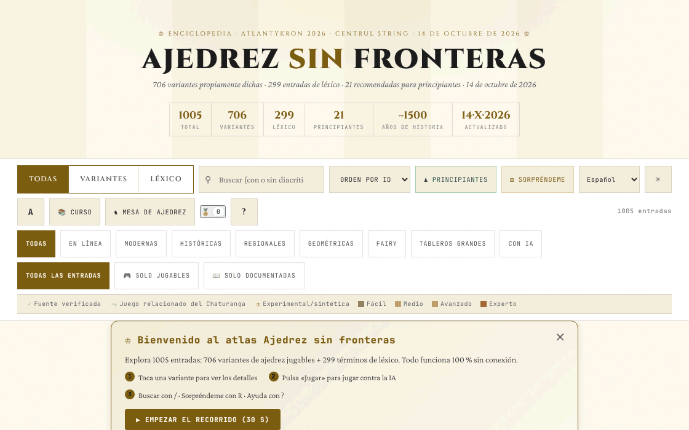

# Șah fără frontiere

[English](README.md) · [Română](README.ro.md) · [Français](README.fr.md) · [Italiano](README.it.md) · **Español** · [Português](README.pt.md) · [Deutsch](README.de.md) · [Magyar](README.hu.md)

**Versión:** 14.6.3 · **Última actualización:** 2026-10-21

Idiomas de la interfaz: **Română, English, Français, Italiano, Español, Português (PT), Deutsch, Magyar**

Atlas/enciclopedia de variantes de ajedrez: 706 variantes y 299 entradas de léxico, con motores jugables para una parte de ellas.

**Aplicación en línea:** https://chiuta.github.io/Sah-fara-frontiere/

## Qué es

Șah fără frontiere («Ajedrez sin fronteras») es un atlas en un solo archivo HTML (v14.6.3, actualizado el 21 de octubre de 2026; el contenido del atlas está fechado el 14 de octubre de 2026; realizado para el taller Atlantykron 2026) con 1005 entradas: 706 variantes de ajedrez (en línea, modernas, históricas, regionales, geométricas, heterodoxas, en tableros grandes, con IA) y 299 términos de léxico (historia, IA, jugadores, aperturas). Según la sección «Acerca de este atlas», el archivo se genera a partir de un script de Python y un JSON de datos, sin dependencias en tiempo de ejecución, con implementación en iteraciones asistidas por IA.

## Funciones

- Búsqueda y filtros: Todas / Variantes / Léxico; categorías (En línea, Modernas, Históricas, Regionales, Geométricas, Heterodoxas, Tableros grandes, Con IA); «Todas las entradas», «Solo jugables», «Solo documentadas»; marcas de fuente (fuente verificada, juego emparentado del Chaturanga, experimental/sintética) y niveles de dificultad.
- Colecciones seleccionadas: «Variante de hoy» (elegida de forma determinista), «Esenciales», «Exóticas», «Nuevas geometrías».
- Botones «Principiantes» y «Sorpréndeme» (variante aleatoria).
- Una ficha para cada entrada, con «▶ Jugar» para las variantes con motor: tablero interactivo, «Reglas: ON», «IA» y «IA contra IA», «Deshacer», «Reiniciar», «Paso», «Girar», sonido, notación (CJK / WXF), pantalla completa, exportación «PGN» y «FEN»; clasificación ELO local.
- «Curso»: un recorrido guiado de 7 días y 17 logros (insignias) desbloqueables.
- «Exportar CSV (todas las entradas)» y «Citar como BibTeX»; botón «Enlace» para compartir.
- Tema oscuro/claro, tres tamaños de texto, zoom.
- «Copia de seguridad del progreso» (en «Acerca de este atlas»): exporta e importa en un archivo JSON el recorrido, las insignias, el ELO y las preferencias locales (las claves `sff:`); al importar se valida el archivo y se pide confirmación.

## Funciones nuevas (14.4.0) — «Mesa de ajedrez»

Se abren desde el botón «Mesa de ajedrez» junto a «Curso», en un cuadro de diálogo con cinco pestañas. **Alcance:** todas las funciones nuevas se refieren al **ajedrez estándar** (reglas FIDE, motor propio, validado mediante perft); las 706 variantes del atlas no están cubiertas (conservan sin cambios su modo «▶ Jugar»).

- **Partida de dos mediante FFF.p2p** — dos personas, WebRTC directamente entre navegadores, **sin servidor**: se intercambian manualmente dos códigos (copiar/pegar o código QR) y luego la partida se desarrolla en «lockstep»: el anfitrión (las blancas) valida y numera cada jugada, el invitado (las negras) la aplica tras el eco del anfitrión; en caso de divergencia se reenvía el estado completo. Tablas y nueva partida mediante oferta con aceptación/rechazo, abandono, exportación PGN, envío de la partida al analizador. **Límites:** sin reloj de ajedrez; sin deshacer jugada; sin chat; la partida no se reanuda tras recargar la página; los adversarios ven mutuamente su dirección IP; los NAT simétricos (redes móviles/corporativas) requieren STUN/TURN, que puede añadirse opcionalmente (vacío por defecto) — entonces la IP pública llega a ese servidor.
- **Analizador local** — «Analizar la posición» (evaluación en peones, mejor jugada, clasificación de las primeras jugadas, mate forzado anunciado explícitamente cuando se encuentra) y «Analizar la partida» (marca las jugadas mucho más débiles que la mejor). Puedes cargar/exportar FEN y PGN. Búsqueda alfa-beta de profundidad fija (determinista, no depende del reloj); **no** es un motor de torneo (no es Stockfish) y la evaluación es aproximada.
- **Desafío del día** — un problema de «mate forzado en 1 o 2» generado **de forma determinista a partir de la fecha** (el mismo para todos el mismo día, sin red); el motor comprueba que existe una única primera jugada ganadora. Jugada errónea: mensaje con el motivo y, en el mate en 2, la defensa del adversario. Racha de días resueltos (local). Si la generación no encuentra una posición, la aplicación usa un problema fijo de reserva y lo dice.
- **«¿Por qué no puedo mover?»** — tocas una pieza o una casilla y la aplicación explica con palabras: casilla vacía, pieza del adversario, geometría de la pieza, camino bloqueado, el propio rey quedaría en jaque, enroque no permitido (rey movido, torre movida, casilla atacada, piezas en medio), captura al paso, promoción, etc.; botón y tecla `W`.
- **Teclado y anuncios de audio** — tablero con 64 botones etiquetados, flechas + Enter, campo de comando (SAN o coordenadas, p. ej. `Nf3`, `e2e4`), teclas `L` (última jugada), `S` (estado), `M` (piezas que pueden mover), `W` (por qué no puedo mover); anuncios en una región `aria-live` y, opcionalmente, voz (Web Speech, si el navegador tiene una voz; en caso contrario lo dice explícitamente).
- **Torneo Elo local** — Yo, IA fácil/media/avanzada y otras personas en el mismo tablero, todos contra todos; las partidas se juegan en el tablero o se simulan IA–IA; clasificación Elo recalculada a partir de los resultados, exportación JSON/CSV e importación. La escala Elo es **interna** al torneo, no comparable con la FIDE. En la simulación IA–IA el nivel avanzado usa profundidad 3 (no 5), las primeras 4 semijugadas son aleatorias a partir de la semilla de la partida, y la partida se detiene a las 200 semijugadas (tablas) — también indicado en la interfaz.

**El motor y su fuerza.** Los niveles: fácil = profundidad 1 con elección entre jugadas casi iguales; medio = profundidad 2; avanzado = profundidad 5 con presupuesto de nodos. En partidas de control (3 aperturas aleatorias × 2 colores, 160 semijugadas): el fácil ganó 12–0 frente a jugadas aleatorias, el avanzado ganó 6–0 frente al medio y 6–0 frente al fácil. Muestras pequeñas: indican el orden, no una fuerza medible en Elo. Las tablas por triple repetición, la regla de las 50 jugadas y el material insuficiente se aplican automáticamente. Sin reloj.

**Idiomas.** La interfaz, los cuadros de diálogo del kit FFF y la Mesa de ajedrez siguen el idioma de la página y están disponibles en rumano, inglés, francés, italiano, español, portugués, húngaro y alemán; el selector de la barra de controles (o el de la pestaña Accesibilidad de la mesa) cambia el idioma de toda la página. El contenido del atlas está traducido así: el texto de las reglas y el subtítulo de las 1005 entradas (706 variantes + 299 entradas de léxico) existen en los 8 idiomas, igual que el curso, la sección «Acerca de este atlas», la meta descripción y unas 430 etiquetas genéricas. **Siguen en rumano:** unas 4000 etiquetas únicas (frases aisladas, p. ej. «960 posiciones»), algunas etiquetas que son nombres o términos ingleses (Lichess, Streaming, …) y, como es natural, los nombres propios (jugadores, motores, productos, organizaciones, aperturas) y las siglas (FIDE, NNUE…). **Las traducciones distintas del rumano y el inglés son automáticas y no están verificadas por hablantes nativos.**

Pruebas: `node tests/fff-r8.test.mjs` (Playwright, red bloqueada, 2 páginas para P2P, axe, 1280×800 y 360×740) y `node tests/engine.test.mjs` (el motor en Node: perft, FEN, SAN, tablas, mate en N, explicaciones).

## Guía de uso

1. Usa el campo de búsqueda y los filtros (Todas, Variantes, Léxico, categorías) para encontrar una entrada; haz clic en una tarjeta para abrirla.
2. En la ficha lee las reglas; si hay motor, pulsa «▶ Jugar».
3. Atajos de teclado (desde la ventana «?»): `/` enfoca la búsqueda; `R` variante aleatoria; `B` variantes para principiantes; `T` cambia el tema; `A` cambia el tamaño del texto; `C` abre el recorrido guiado; `?` ayuda; `Esc` cierra las ventanas; `Enter` o `Espacio` abre la tarjeta enfocada; `Tab` / `Mayús+Tab` navegación.
4. «📚 Curso» abre el recorrido de 7 días; el progreso se guarda localmente y «Restablecer progreso» lo borra.
5. En la partida puedes exportar la posición o la partida con «PGN» / «FEN».
6. «Acerca de este atlas →» contiene información sobre el atlas, la versión y el autor; desde ahí se pueden exportar las entradas a CSV o BibTeX.

## Privacidad y red

- Local: en `localStorage`, con el prefijo `sff:` — el estado del atlas (`sff:state:v2`), el recorrido (`sff:curriculum:v1`), el tema, el tamaño del texto, el sonido, el estilo de notación y de glifos, las insignias, las estadísticas de juego, el ELO del jugador, el estado de la partida en curso y las marcas de «bienvenida»/recorrido visto.
- Las funciones de la «Mesa de ajedrez» usan claves distintas `sff_r8_` (preferencias de anuncios/voz, torneo, racha diaria, caché del problema del día); el kit FFF añade copia de seguridad (exportar/importar/borrar) y la ventana «Transparencia» desde el número de versión.
- La única comunicación de red nueva es la partida de dos opcional, mediante WebRTC directamente entre los dos jugadores, con señalización manual y, solo si introduces uno, un servidor STUN (egress declarado: 0).
- Red: en el código verificado no hay llamadas `fetch` ni scripts/fuentes cargados desde hosts externos. Las fichas contienen enlaces a fuentes (por ejemplo Wikipedia, FIDE Handbook, Lichess, chessvariants.com), que solo se abren si haces clic en ellos. El texto de la aplicación afirma: «Funciona sin conexión, sin rastreo, sin anuncios».
- El motor de IA se ejecuta localmente en el navegador.

## Ejecución local / offline

Descarga `index.html` (unos 2,4 MB) y ábrelo en un navegador; funciona sin internet. Solo los enlaces a fuentes externas requieren conexión.

## Historial / Changelog

### v14.6.3 — 21 de octubre de 2026
- Verificadas y corregidas 26 entradas del atlas (p. ej. la Olimpiada no oficial de Múnich 1936, la biografía de Steinitz, el número de federaciones); seis conceptos de ajedrez heterodoxo no atestiguados llevan ahora la nota «concepto no atestiguado». Unas 2.700 etiquetas más traducidas a los 7 idiomas no rumanos (3.183 filas en total); nombres propios, años y siglas no cambian.

### v14.6.2 — 19 de octubre de 2026
- La «Mesa de ajedrez» y sus funciones (partida de dos, analizador, desafío del día, «¿por qué no puedo mover?», juego con teclado y audio, torneo Elo local) están presentes en la versión actual: el script se había eliminado por error en una limpieza anterior y se restauró (14.6.0) con el mismo comportamiento; se actualizaron las pruebas. Los textos de la mesa siguen ahora el idioma de la página (se eliminó la preferencia de idioma independiente).
- Contenido del atlas traducido a 8 idiomas: texto de las reglas y subtítulo de las 1005 entradas, el curso, «Acerca de este atlas», la meta descripción y unas 430 etiquetas genéricas; corregido: el título «ȘAH» se traducía por error como «jaque» (la jugada) en lugar de «ajedrez».

### v14.4.0 — 14 de octubre de 2026 (ronda 8, C1a)
- «Mesa de ajedrez» para el ajedrez estándar: partida de dos P2P (sin servidor), analizador local, desafío del día determinado por la fecha, «¿por qué no puedo mover?», juego con teclado con anuncios de audio, torneo Elo local; 8 idiomas para los textos nuevos.
- Kit FFF (core, label, bundle, qr, p2p, tts) con `app.json`; CSP con hashes recalculados; copia de seguridad y ventana «Transparencia» desde el número de versión; pruebas `tests/fff-r8.test.mjs` y `tests/engine.test.mjs`.
- El atlas (1005 entradas) y el modo «▶ Jugar» existente no cambian (verificado en una prueba).

### v14.3.1 — 12 de octubre de 2026
- La versión y la fecha de la última actualización se muestran en la aplicación («Acerca de este atlas», pie de página); el título, la cabecera, la estadística «Actualizado» y el BibTeX muestran v14.3.1 / 12 de octubre de 2026.

### v14.3 — 11 de octubre de 2026
- En pantallas estrechas (≤820 px) o bajas (≤560 px) la barra de comandos ya no queda pegada arriba: en el teléfono ocupaba ≈620 px de 740 y cubría las tarjetas (el clic en las primeras tarjetas ya no llegaba a ellas); en escritorio, las tarjetas tienen `scroll-margin-top` para no quedar bajo la barra fija.
- Indicador visual «La IA está pensando… N s» bajo el tablero mientras la IA calcula (el estado sigue anunciándose también mediante la región `aria-live` existente); respeta `prefers-reduced-motion`.
- El banner «Bienvenida» aparece ahora en la parte superior del contenido (antes de «Variante de hoy»), no bajo las secciones seleccionadas.
- El tamaño (≈1,9 MB) se mantiene: ~1,05 MB son datos (ya compactos) y ~230 KB de fuentes en base64 para el funcionamiento sin conexión.

### v14.2 — 11 de octubre de 2026
- Seguridad: la política CSP ya no contiene `'unsafe-inline'`, `'wasm-unsafe-eval'` ni `blob:` para scripts (los scripts en línea se autorizan ahora mediante hash SHA-256); `worker-src` es `'none'`.
- Exportación/importación del progreso local (insignias, recorrido, ELO, preferencias) desde «Acerca de este atlas».
- Versión actualizada a v14.2 (README, visualización en la aplicación, BibTeX).

### v14.1 — 11 de octubre de 2026
- Accesibilidad: el cuadro de detalles tiene ahora un título implícito (nombre accesible), el bloque «Apoya» es una región etiquetada (aside); comprobación axe sin infracciones.
- Eliminado el manejador onclick en línea de la advertencia de navegador incompatible (sustituido por un listener).
- Fecha y versión actualizadas: v14.1, 11 de octubre de 2026 (título, cabecera, estadística «Actualizado», BibTeX).

## Licencia

MIT — véase el archivo `LICENSE`. La cabecera de `index.html` y el texto de la interfaz indican la misma licencia (una mención anterior de «CC-BY-SA 4.0» en la interfaz se eliminó en la auditoría, 2026-10-11, para eliminar la contradicción).

Excepción — materiales de terceros: los resúmenes y descripciones de algunas variantes se apoyan en fuentes públicas (Wikipedia, FIDE, Lichess, chessvariants.com), indicadas en la aplicación como enlaces y agradecimientos. La licencia MIT cubre la contribución original del autor (código, selección, textos propios); cualquier texto tomado o adaptado de terceros permanece bajo la licencia de la fuente (p. ej. CC BY-SA para Wikipedia) y debe ser verificado por quien lo reutilice.

## Marcas

Los nombres de juegos son denominaciones comerciales de sus titulares, usadas de forma descriptiva; el proyecto no está afiliado a ellos.

## Autor

Alexio — Alexandru-Ionuț Chiuță, contacto: alexio@trom.tf. La aplicación lo presenta como autor, desarrollador y músico, con menciones del proyecto TROM, de Editura Tornada y del Centrul StrING.

## Resumen

Șah fără frontiere es un atlas de variantes de ajedrez en un solo archivo: 706 variantes más 299 entradas de léxico, con búsqueda, filtros, motores jugables (IA local, exportación PGN/FEN, ELO local), un curso guiado de 7 días, insignias y exportación CSV/BibTeX. Desde la 14.4.0 una «Mesa de ajedrez» para el ajedrez estándar añade juego de dos mediante WebRTC (señalización manual, sin servidor), un analizador local sencillo, un problema de mate diario determinista, explicaciones «¿por qué no puedo mover?», juego con teclado con anuncios hablados y un torneo Elo local (las 706 variantes no están cubiertas). Todo se ejecuta en local; el progreso se guarda en localStorage (claves `sff:`) y no se encontraron solicitudes externas en el código. Licenciado bajo MIT para la contribución propia del autor (véase LICENSE); los resúmenes derivados de terceros conservan sus licencias de origen.

## Auditoría

Auditoría: 2026-10-10 — afirmación «sin red» verificada (0 `fetch`/XHR/WebSocket, CSP `connect-src 'self'`, solo enlaces `<a>` externos); corregidos el contraste del tema claro y la semántica de las tarjetas (los botones de etiqueta en las tarjetas ya no están anidados en un `role="button"`). La licencia se unificó (2026-10-11) y después se estableció como MIT, y se añadió `LICENSE`. Algunas variantes están marcadas en la aplicación como «experimentales/sintéticas» (sin fuente primaria): trata sus reglas como no verificadas.
