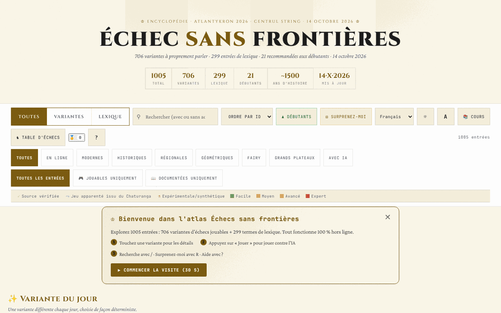

# Șah fără frontiere

[English](README.md) · [Română](README.ro.md) · **Français** · [Italiano](README.it.md) · [Español](README.es.md) · [Português](README.pt.md) · [Deutsch](README.de.md) · [Magyar](README.hu.md)

**Version :** 15.1.0 · **Dernière mise à jour :** 2026-10-27

Langues de l'interface : **Română, English, Français, Italiano, Español, Português (PT), Deutsch, Magyar**

Atlas/encyclopédie de variantes d'échecs : 706 variantes et 299 entrées de lexique, avec des moteurs jouables pour une partie d'entre elles.

**Application en ligne :** https://chiuta.github.io/Sah-fara-frontiere/

## Présentation

Șah fără frontiere (« Échecs sans frontières ») est un atlas dans un seul fichier HTML (v14.6.4, mis à jour le 22 octobre 2026 ; le contenu de l'atlas est daté du 14 octobre 2026 ; réalisé pour l'atelier Atlantykron 2026) comptant 1005 entrées : 706 variantes d'échecs (en ligne, modernes, historiques, régionales, géométriques, féeriques, sur grands échiquiers, avec IA) et 299 termes de lexique (histoire, IA, joueurs, ouvertures). Selon la section « À propos de cet atlas », le fichier est généré à partir d'un script Python et d'un JSON de données, sans dépendances à l'exécution, avec une mise en œuvre par itérations assistées par IA.

## Fonctionnalités

- Recherche et filtres : Toutes / Variantes / Lexique ; catégories (En ligne, Modernes, Historiques, Régionales, Géométriques, Féeriques, Grands échiquiers, Avec IA) ; « Toutes les entrées », « Jouables uniquement », « Documentées uniquement » ; marqueurs de source (source vérifiée, jeu apparenté du Chaturanga, expérimentale/synthétique) et niveaux de difficulté.
- Collections choisies : « Variante du jour » (choisie de façon déterministe), « Essentielles », « Exotiques », « Nouvelles géométries ».
- Boutons « Débutants » et « Surprenez-moi » (variante aléatoire).
- Une fiche pour chaque entrée, avec « ▶ Jouer » pour les variantes dotées d'un moteur : échiquier interactif, « Règles : ON », « IA » et « IA contre IA », « Annuler », « Réinitialiser », « Pas », « Retourner », son, notation (CJK / WXF), plein écran, export « PGN » et « FEN » ; classement ELO local.
- « Cours » : un parcours guidé de 7 jours et 17 réalisations (badges) à débloquer.
- « Exporter en CSV (toutes les entrées) » et « Citer en BibTeX » ; bouton « Lien » pour le partage.
- Thème sombre/clair, trois tailles de texte, zoom.
- « Sauvegarde de la progression » (dans « À propos de cet atlas ») : exporte et importe dans un fichier JSON le parcours, les badges, l'ELO et les préférences locales (les clés `sah-fara-frontiere.`) ; à l'import, le fichier est validé et une confirmation est demandée.

## Nouvelles fonctionnalités (14.4.0) — « Table d'échecs »

Elles s'ouvrent depuis le bouton « Table d'échecs » à côté de « Cours », dans une boîte de dialogue à cinq onglets. **Périmètre :** toutes les nouvelles fonctionnalités concernent les **échecs standard** (règles FIDE, moteur propre, validé par perft) ; les 706 variantes de l'atlas ne sont pas couvertes (elles conservent inchangé leur mode « ▶ Jouer »).

- **Partie à deux via FFF.p2p** — deux personnes, WebRTC directement entre navigateurs, **sans serveur** : vous échangez manuellement deux codes (copier/coller ou code QR), puis la partie se déroule en « lockstep » : l'hôte (les Blancs) valide et numérote chaque coup, l'invité (les Noirs) l'applique après l'écho de l'hôte ; en cas de divergence, l'état complet est renvoyé. Nulle et nouvelle partie par offre avec acceptation/refus, abandon, export PGN, envoi de la partie à l'analyseur. **Limites :** pas de pendule ; pas d'annulation de coup ; pas de chat ; la partie ne reprend pas après le rechargement de la page ; les adversaires voient mutuellement leur adresse IP ; les NAT symétriques (réseaux mobiles/d'entreprise) exigent STUN/TURN, qui peut être ajouté en option (vide par défaut) — l'IP publique parvient alors à ce serveur.
- **Analyseur local** — « Analyser la position » (évaluation en pions, meilleur coup, classement des meilleurs coups, mat forcé annoncé explicitement lorsqu'il est trouvé) et « Analyser la partie » (signale les coups bien plus faibles que le meilleur). Vous pouvez charger/exporter FEN et PGN. Recherche alpha-bêta à profondeur fixe (déterministe, indépendante de l'horloge) ; ce **n'est pas** un moteur de tournoi (ce n'est pas Stockfish) et l'évaluation est approximative.
- **Défi du jour** — un problème de « mat forcé en 1 ou 2 coups » généré **de façon déterministe à partir de la date** (le même pour tout le monde le même jour, sans réseau) ; le moteur vérifie qu'il n'existe qu'un seul premier coup gagnant. Coup erroné : message avec la raison et, pour un mat en 2, la défense de l'adversaire. Série de jours résolus (locale). Si la génération ne trouve pas de position, l'application utilise un problème fixe de secours et le dit.
- **« Pourquoi ne puis-je pas jouer ? »** — vous touchez une pièce ou une case et l'application explique en mots : case vide, pièce de l'adversaire, géométrie de la pièce, chemin bloqué, son propre roi resterait en échec, roque non autorisé (roi déjà bougé, tour déjà bougée, case attaquée, pièces entre les deux), prise en passant, promotion, etc. ; bouton et touche `W`.
- **Clavier et annonces audio** — échiquier de 64 boutons étiquetés, flèches + Entrée, champ de commande (SAN ou coordonnées, p. ex. `Nf3`, `e2e4`), touches `L` (dernier coup), `S` (état), `M` (pièces pouvant jouer), `W` (pourquoi je ne peux pas jouer) ; annonces dans une région `aria-live` et, en option, voix (Web Speech, si le navigateur dispose d'une voix ; sinon, il le dit explicitement).
- **Tournoi Elo local** — Moi, IA facile/moyenne/avancée et d'autres personnes au même échiquier, toutes rondes ; les parties se jouent sur l'échiquier ou sont simulées IA–IA ; classement Elo recalculé à partir des résultats, export JSON/CSV et import. L'échelle Elo est **interne** au tournoi, non comparable à la FIDE. Dans la simulation IA–IA, le niveau avancé utilise une profondeur de 3 (et non 5), les 4 premiers demi-coups sont aléatoires à partir de la graine du match, et la partie s'arrête à 200 demi-coups (nulle) — également indiqué dans l'interface.

**Le moteur et sa force.** Les niveaux : facile = profondeur 1 avec choix parmi des coups presque égaux ; moyen = profondeur 2 ; avancé = profondeur 5 avec budget de nœuds. Lors de parties de contrôle (3 ouvertures aléatoires × 2 couleurs, 160 demi-coups) : le niveau facile a gagné 12–0 contre des coups aléatoires, l'avancé a gagné 6–0 contre le moyen et 6–0 contre le facile. Petits échantillons : ils indiquent l'ordre, non une force mesurable en Elo. La nulle par triple répétition, la règle des 50 coups et le matériel insuffisant s'appliquent automatiquement. Pas de pendule.

**Langues.** L'interface, les boîtes de dialogue du kit FFF et la Table d'échecs suivent la langue de la page et sont disponibles en roumain, anglais, français, italien, espagnol, portugais, hongrois et allemand ; le sélecteur de la barre de contrôles (ou celui de l'onglet Accessibilité de la table) change la langue de toute la page. Le contenu de l'atlas est traduit ainsi : le texte des règles et le sous-titre des 1005 entrées (706 variantes + 299 entrées de lexique) existent dans les 8 langues, de même que le cours, la section « À propos de cet atlas », la méta-description et environ 430 étiquettes génériques. **Restent en roumain :** environ 4000 étiquettes uniques (phrases isolées, par ex. « 960 positions »), certaines étiquettes qui sont des noms ou termes anglais (Lichess, Streaming, …) et, naturellement, les noms propres (joueurs, moteurs, produits, organisations, ouvertures) et les acronymes (FIDE, NNUE…). **Les traductions autres que le roumain et l'anglais sont automatiques et non vérifiées par des locuteurs natifs.**

Tests : `node tests/fff-r8.test.mjs` (Playwright, réseau bloqué, 2 pages pour le P2P, axe, 1280×800 et 360×740) et `node tests/engine.test.mjs` (le moteur sous Node : perft, FEN, SAN, nulles, mat en N, explications).

## Mode d'emploi

1. Utilisez le champ de recherche et les filtres (Toutes, Variantes, Lexique, catégories) pour trouver une entrée ; cliquez sur une carte pour l'ouvrir.
2. Dans la fiche, lisez les règles ; s'il existe un moteur, appuyez sur « ▶ Jouer ».
3. Raccourcis clavier (depuis la fenêtre « ? ») : `/` active la recherche ; `R` variante aléatoire ; `B` variantes pour débutants ; `T` change le thème ; `A` change la taille du texte ; `C` ouvre le parcours guidé ; `?` aide ; `Échap` ferme les fenêtres ; `Entrée` ou `Espace` ouvre la carte ciblée ; `Tab` / `Maj+Tab` navigation.
4. « 📚 Cours » ouvre le parcours de 7 jours ; la progression est enregistrée localement, et « Réinitialiser la progression » l'efface.
5. En cours de partie, vous pouvez exporter la position ou la partie avec « PGN » / « FEN ».
6. « À propos de cet atlas → » contient des informations sur l'atlas, la version et l'auteur ; on peut de là exporter les entrées en CSV ou en BibTeX.

## Confidentialité et réseau

- Local : dans `localStorage`, avec le préfixe `sah-fara-frontiere.` — l'état de l'atlas (`sah-fara-frontiere.state:v2`), le parcours (`sah-fara-frontiere.curriculum:v1`), le thème, la taille du texte, le son, le style de notation et de glyphes, les badges, les statistiques de jeu, l'ELO du joueur, l'état de la partie en cours et les marqueurs « bienvenue »/visite vue.
- Les fonctionnalités de la « Table d'échecs » utilisent des clés distinctes `sff_r8_` (préférences d'annonces/voix, tournoi, série quotidienne, cache du problème du jour) ; le kit FFF ajoute une sauvegarde (export/import/suppression) et la fenêtre « Transparence » depuis le numéro de version.
- La seule nouvelle communication réseau est la partie à deux facultative, via WebRTC directement entre les deux joueurs, avec signalisation manuelle et, uniquement si vous en saisissez un, un serveur STUN (egress déclaré : 0).
- Réseau : dans le code vérifié, il n'y a aucun appel `fetch` ni script/police chargé depuis des hôtes externes. Les fiches contiennent des liens vers des sources (par exemple Wikipedia, FIDE Handbook, Lichess, chessvariants.com), qui ne s'ouvrent que si vous cliquez dessus. Le texte de l'application affirme : « Fonctionne hors ligne, sans pistage, sans publicités ».
- Le moteur d'IA s'exécute localement dans le navigateur.

## Exécution locale / hors ligne

Téléchargez `index.html` (environ 2,4 Mo) et ouvrez-le dans un navigateur ; il fonctionne sans internet. Seuls les liens vers des sources externes nécessitent une connexion.

## Historique / Changelog
### 14.6.13 — 2026-10-23

- Cibles tactiles d’au moins 44 px sur les appareils tactiles (`pointer:coarse`) ; le bureau reste inchangé.

### 14.6.12 — 2026-10-23

- Les clés du stockage local utilisent désormais le préfixe `sah-fara-frontiere.` (`FFF.store.migrate` au démarrage, avant toute lecture) : les données existantes sont conservées automatiquement et les anciennes sauvegardes `.fff.json` restent importables.

- **14.6.10 — 2026-10-22:** Poids et DOM : la page passe de 8,4 Mo à 3,2 Mo et d’environ 22 500 à environ 1 700 nœuds DOM au démarrage. Les 1 005 cartes sont créées comme de simples squelettes (aria-label, tabindex) et leur contenu n’est construit que lorsqu’elles approchent de la fenêtre (IntersectionObserver, marge de 1 400 px) puis libéré quand elles s’éloignent, en gardant la hauteur mesurée pour que le défilement ne saute pas ; la surbrillance de la recherche est appliquée à l’hydratation. Les traductions du contenu (en, fr, it, es, pt, de, hu ; 5,3 Mo) sont dans `i18n/vi18n-<langue>.js`, chargés seulement pour la langue choisie (plus l’anglais en secours) ; le service worker les met en cache et, quand la page est inactive, télécharge le reste en arrière-plan (sauf avec Save-Data / connexion lente), de sorte que l’application reste entièrement hors ligne ; si un pack ne peut pas être chargé, un avis s’affiche dans la langue choisie. Cibles tactiles de 44 px sur pointeur grossier pour les boutons de réussites, à propos, bannière de bienvenue et aide. Nouveau test : `tests/lazy.test.mjs`.

### 14.6.9 — 2026-10-22

fff-kit 1.1.4 : cibles tactiles et taille de texte minimale; cibles tactiles et texte corrigés.

- 14.6.8 — 2026-10-22 : fff-kit 1.1.2 : PBKDF2 à 600 000 itérations, protection anti-clickjacking
- 14.6.7 — 2026-10-22: les confirmations et solutions de copie utilisent des dialogues intégrés traduits au lieu de confirm()/prompt() ; vrai service worker et manifeste pour un démarrage hors ligne ; finitions mobile et accessibilité : texte d’au moins 12 px et cibles tactiles d’au moins 24 px.
- **14.6.6 — 2026-10-22:** les infobulles et étiquettes d'accessibilité des badges « variante expérimentale » et « jeu apparenté » sont désormais traduites dans toutes les langues (elles restaient en roumain).
### 14.6.5 — 2026-10-22
- Corrections de traduction : le titre de la page et les balises meta suivent la langue de l’interface ; les libellés des boutons de filtre par étiquette et des types d’échiquier sont traduits dans les 8 langues.

### v14.6.4 — 22 octobre 2026
- Entrée 460 (Arménie) corrigée : les trois titres olympiques (2006, 2008, 2012) n'étaient pas consécutifs (l'Ukraine a gagné en 2010) et Aronian était deuxième, et non troisième, mondial en 2014 ; la formule « triplé » a été retirée dans les 8 langues. Vérification factuelle des 26 entrées signalées ; aucune autre erreur trouvée.

### v14.6.3 — 21 octobre 2026
- 26 entrées de l'atlas vérifiées et corrigées (p. ex. l'Olympiade non officielle de Munich 1936, la biographie de Steinitz, le nombre de fédérations) ; six concepts d'échecs féeriques non attestés portent désormais la mention « concept non attesté ». Environ 2 700 libellés supplémentaires traduits dans les 7 langues non roumaines (3 183 lignes au total) ; noms propres, années et sigles restent inchangés.

### v14.6.2 — 19 octobre 2026
- La « Table d'échecs » et ses fonctionnalités (partie à deux, analyseur, défi du jour, « pourquoi ne puis-je pas jouer ? », jeu au clavier et audio, tournoi Elo local) sont présentes dans la version actuelle : le script avait été supprimé par erreur lors d'un nettoyage antérieur et a été restauré (14.6.0) avec le même comportement ; les tests ont été mis à jour. Les textes de la table suivent désormais la langue de la page (la préférence de langue distincte a été supprimée).
- Contenu de l'atlas traduit en 8 langues : texte des règles et sous-titre des 1005 entrées, cours, « À propos de cet atlas », méta-description et environ 430 étiquettes génériques ; corrigé : le titre « ȘAH » était traduit à tort par « échec » (le coup) au lieu de « échecs » (le jeu).

### v14.4.0 — 14 octobre 2026 (tour 8, C1a)
- « Table d'échecs » pour les échecs standard : partie à deux P2P (sans serveur), analyseur local, défi du jour déterminé par la date, « pourquoi ne puis-je pas jouer ? », jeu au clavier avec annonces audio, tournoi Elo local ; 8 langues pour les nouveaux textes.
- Kit FFF (core, label, bundle, qr, p2p, tts) avec `app.json` ; CSP avec hachages recalculés ; sauvegarde et fenêtre « Transparence » depuis le numéro de version ; tests `tests/fff-r8.test.mjs` et `tests/engine.test.mjs`.
- L'atlas (1005 entrées) et le mode « ▶ Jouer » existant sont inchangés (vérifié par test).

### v14.3.1 — 12 octobre 2026
- La version et la date de dernière mise à jour sont affichées dans l'application (« À propos de cet atlas », pied de page) ; le titre, l'en-tête, la statistique « Mis à jour » et le BibTeX indiquent v14.3.1 / 12 octobre 2026.

### v14.3 — 11 octobre 2026
- Sur les écrans étroits (≤820 px) ou courts (≤560 px), la barre de commandes ne reste plus collée en haut : sur téléphone, elle occupait ≈620 px sur 740 et recouvrait les cartes (le clic sur les premières cartes ne les atteignait plus) ; sur ordinateur, les cartes ont `scroll-margin-top` afin de ne pas rester sous la barre collée.
- Indicateur visuel « L'IA réfléchit… N s » sous l'échiquier pendant le calcul de l'IA (l'état reste annoncé aussi par la région `aria-live` existante) ; respecte `prefers-reduced-motion`.
- La bannière « Bienvenue » apparaît désormais en tête du contenu (avant « Variante du jour »), et non sous les sections choisies.
- La taille (≈1,9 Mo) reste : ~1,05 Mo sont des données (déjà compactes) et ~230 Ko de polices en base64 pour le fonctionnement hors ligne.

### v14.2 — 11 octobre 2026
- Sécurité : la politique CSP ne contient plus `'unsafe-inline'`, `'wasm-unsafe-eval'` ni `blob:` pour les scripts (les scripts en ligne sont désormais autorisés par hachage SHA-256) ; `worker-src` vaut `'none'`.
- Export/import de la progression locale (badges, parcours, ELO, préférences) depuis « À propos de cet atlas ».
- Version mise à jour en v14.2 (README, affichage dans l'application, BibTeX).

### v14.1 — 11 octobre 2026
- Accessibilité : la boîte de dialogue de détails a désormais un titre implicite (nom accessible), le bloc « Soutenir » est une région étiquetée (aside) ; vérification axe sans violation.
- Suppression du gestionnaire onclick en ligne de l'avertissement de navigateur incompatible (remplacé par un écouteur).
- Date et version mises à jour : v14.1, 11 octobre 2026 (titre, en-tête, statistique « Mis à jour », BibTeX).

## Licence

MIT — voir le fichier `LICENSE`. L'en-tête de `index.html` et le texte de l'interface indiquent la même licence (une ancienne mention « CC-BY-SA 4.0 » dans l'interface a été supprimée lors de l'audit, 2026-10-11, pour éliminer la contradiction).

Exception — matériaux de tiers : les résumés et descriptions de certaines variantes s'appuient sur des sources publiques (Wikipedia, FIDE, Lichess, chessvariants.com), indiquées dans l'application sous forme de liens et de remerciements. La licence MIT couvre la contribution originale de l'auteur (code, sélection, textes propres) ; tout texte repris ou adapté de tiers reste sous la licence de la source (p. ex. CC BY-SA pour Wikipedia) et doit être vérifié par quiconque le réutilise.

## Marques

Les noms de jeux sont des dénominations commerciales de leurs titulaires, utilisées à titre descriptif ; le projet n'est pas affilié à ceux-ci.

## Auteur

Alexio — Alexandru-Ionuț Chiuță, contact : alexio@trom.tf. L'application le présente comme auteur, développeur et musicien, avec des mentions du projet TROM, des éditions Tornada et du Centrul StrING.

## Résumé
Șah fără frontiere est un atlas de variantes d'échecs en un seul fichier : 706 variantes plus 299 entrées de lexique, avec recherche, filtres, moteurs jouables (IA locale, export PGN/FEN, ELO local), un cours guidé de 7 jours, des badges et un export CSV/BibTeX. Depuis la 14.4.0, une « Table d'échecs » pour les échecs standard ajoute le jeu à deux via WebRTC (signalisation manuelle, sans serveur), un analyseur local simple, un problème de mat quotidien déterministe, des explications « pourquoi ne puis-je pas jouer ? », le jeu au clavier avec annonces vocales et un tournoi Elo local (les 706 variantes ne sont pas couvertes). Tout s'exécute en local ; la progression est conservée dans localStorage (clés `sah-fara-frontiere.`) et aucune requête externe n'a été trouvée dans le code. Sous licence MIT pour la contribution propre de l'auteur (voir LICENSE) ; les résumés dérivés de tiers conservent leurs licences d'origine.

## Audit

Audit : 2026-10-10 — l'affirmation « sans réseau » vérifiée (0 `fetch`/XHR/WebSocket, CSP `connect-src 'self'`, uniquement des liens `<a>` externes) ; contraste du thème clair et sémantique des cartes corrigés (les boutons d'étiquette dans les cartes ne sont plus imbriqués dans un `role="button"`). La licence a été unifiée (2026-10-11), puis établie comme MIT, et `LICENSE` a été ajouté. Certaines variantes sont marquées dans l'application comme « expérimentales/synthétiques » (sans source primaire) : considérez leurs règles comme non vérifiées.
