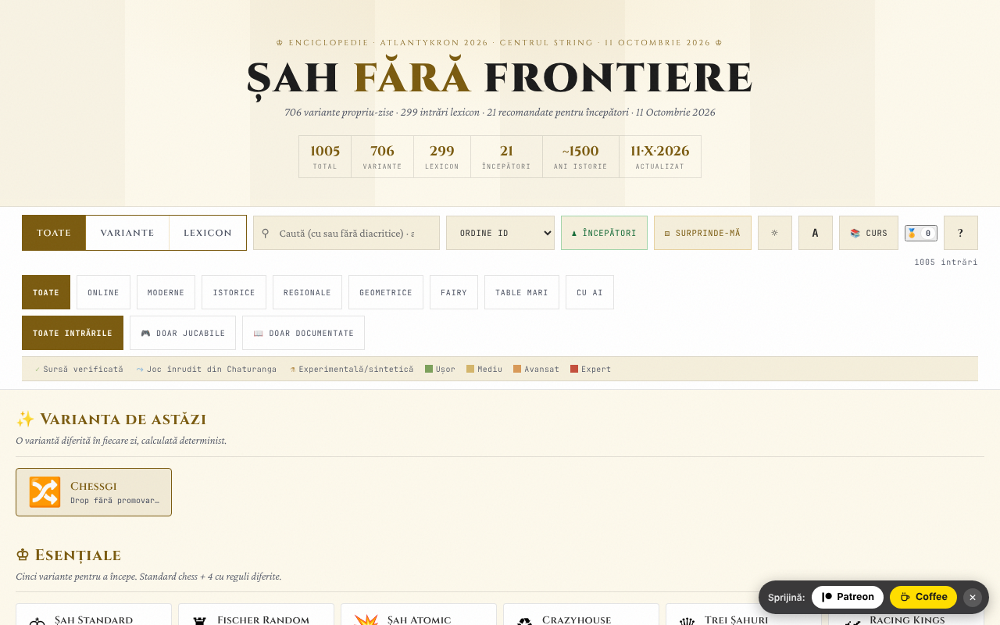

# Șah fără frontiere

[English](README.md) · [Română](README.ro.md) · [Français](README.fr.md) · [Italiano](README.it.md) · [Español](README.es.md) · [Português](README.pt.md) · [Deutsch](README.de.md) · **Magyar**

**Verzió:** 14.4.0 · **Utolsó frissítés:** 2026-10-14

Sakkváltozatok atlasza/enciklopédiája: 706 változat és 299 szótári bejegyzés, a változatok egy részéhez játszható motorokkal.

**Online alkalmazás:** https://chiuta.github.io/Sah-fara-frontiere/

## Mi ez

A Șah fără frontiere („Sakk határok nélkül”) egyetlen HTML-fájlból álló atlasz (v14.4.0, frissítve 2026. október 14-én; az Atlantykron 2026 műhelyhez készült) 1005 bejegyzéssel: 706 sakkváltozat (online, modern, történelmi, regionális, geometriai, tündérsakk, nagy táblás, MI-s) és 299 szótári kifejezés (történelem, MI, játékosok, megnyitások). Az „Erről az atlaszról” szakasz szerint a fájlt egy Python-szkript és egy JSON-adatfájl generálja, futásidejű függőségek nélkül, MI-támogatású iterációkban megvalósítva.

## Funkciók

- Keresés és szűrők: Mind / Változatok / Szótár; kategóriák (Online, Modern, Történelmi, Regionális, Geometriai, Tündérsakk, Nagy táblák, MI-vel); „Minden bejegyzés”, „Csak játszható”, „Csak dokumentált”; forrásjelölések (ellenőrzött forrás, rokon játék a Csaturangából, kísérleti/szintetikus) és nehézségi szintek.
- Válogatott gyűjtemények: „A nap változata” (determinisztikusan kiválasztva), „Alapok”, „Egzotikus”, „Új geometriák”.
- „Kezdők” és „Lepj meg” gombok (véletlen változat).
- Minden bejegyzéshez adatlap, a motorral rendelkező változatoknál „▶ Játék” gombbal: interaktív tábla, „Szabályok: ON”, „MI” és „MI az MI ellen”, „Visszavonás”, „Alaphelyzet”, „Lépés”, „Megfordítás”, hang, jelölés (CJK / WXF), teljes képernyő, „PGN” és „FEN” export; helyi ELO-ranglista.
- „Tanfolyam”: vezetett 7 napos útvonal és 17 feloldható teljesítmény (jelvény).
- „CSV-export (minden bejegyzés)” és „Hivatkozás BibTeX-ként”; „Hivatkozás” gomb a megosztáshoz.
- Sötét/világos téma, három szövegméret, nagyítás.
- „Haladás biztonsági mentése” (az „Erről az atlaszról” részben): JSON-fájlba exportálja és onnan importálja a tanfolyamot, a jelvényeket, az ELO-t és a helyi beállításokat (az `sff:` kulcsokat); importáláskor a fájl érvényesítésre kerül, és megerősítést kér.

## Új funkciók (14.4.0) — „Sakkasztal”

A „Tanfolyam” melletti „Sakkasztal” gombról nyílnak meg, ötfülés párbeszédablakban. **Hatókör:** minden új funkció a **hagyományos sakkra** vonatkozik (FIDE-szabályok, saját motor, perft-tel validálva); az atlasz 706 változata nem érintett (megőrzik változatlan „▶ Játék” módjukat).

- **Kétszemélyes játék az FFF.p2p-n keresztül** — két személy, WebRTC közvetlenül a böngészők között, **szerver nélkül**: kézzel cseréltek két kódot (másolás/beillesztés vagy QR-kód), majd a játék „lockstep” módban zajlik: a házigazda (világos) érvényesíti és megszámozza minden lépést, a vendég (sötét) a házigazda visszhangja után alkalmazza; eltérés esetén a teljes állapotot újraküldik. Döntetlen és új játék felajánlással, elfogadással/elutasítással, feladás, PGN-export, a játszma elküldése az elemzőbe. **Korlátok:** nincs sakkóra; nincs lépés-visszavonás; nincs csevegés; a játszma az oldal újratöltése után nem folytatódik; az ellenfelek látják egymás IP-címét; a szimmetrikus NAT-ok (mobil-/vállalati hálózatok) STUN/TURN-t igényelnek, amely opcionálisan hozzáadható (alapértelmezés szerint üres) — ekkor a nyilvános IP eljut ahhoz a szerverhez.
- **Helyi elemző** — „Állás elemzése” (értékelés gyalogokban, legjobb lépés, a legjobb lépések rangsora, a kikényszerített matt kifejezett jelzése, ha megtalálta) és „Játszma elemzése” (megjelöli a legjobbnál sokkal gyengébb lépéseket). Betölthetsz/exportálhatsz FEN-t és PGN-t. Rögzített mélységű alfa-béta keresés (determinisztikus, nem függ az órától); **nem** versenymotor (nem Stockfish), és az értékelés hozzávetőleges.
- **A nap feladványa** — „kikényszerített matt 1 vagy 2 lépésben” feladvány, **determinisztikusan a dátumból** generálva (ugyanaz mindenkinek ugyanazon a napon, hálózat nélkül); a motor ellenőrzi, hogy pontosan egy nyerő első lépés létezik. Hibás lépés: üzenet az okkal, és 2 lépéses mattnál az ellenfél védekezésével. Megoldott napok sorozata (helyi). Ha a generálás nem talál állást, az alkalmazás egy rögzített tartalék feladványt használ, és ezt közli.
- **„Miért nem léphetek?”** — megérintesz egy bábut vagy mezőt, és az alkalmazás szavakkal elmagyarázza: üres mező, az ellenfél bábuja, a bábu geometriája, elzárt út, a saját király sakkban maradna, a sáncolás nem megengedett (király lépett, bástya lépett, támadott mező, bábuk köztük), en passant, átváltozás stb.; gomb és a `W` billentyű.
- **Billentyűzet és hangbemondás** — tábla 64 felirattal ellátott gombbal, nyilak + Enter, parancsmező (SAN vagy koordináták, pl. `Nf3`, `e2e4`), `L` (utolsó lépés), `S` (állapot), `M` (lépni tudó bábuk), `W` (miért nem léphetek) billentyűk; bemondások `aria-live` régióban, és opcionálisan hang (Web Speech, ha a böngészőben van hang; különben kifejezetten közli, hogy nincs).
- **Helyi Elo-verseny** — Én, könnyű/közepes/haladó MI és más személyek ugyanannál a táblánál, körmérkőzés; a mérkőzéseket a táblán játsszák vagy MI–MI szimulálják; az eredményekből újraszámolt Elo-ranglista, JSON/CSV-export és -import. Az Elo-skála a versenyen **belüli**, nem összevethető a FIDE-vel. Az MI–MI szimulációban a haladó szint 3-as mélységet használ (nem 5-öt), az első 4 fél lépés a mérkőzés magjából véletlenszerű, és a játszma 200 fél lépésnél véget ér (döntetlen) — ezt a felület is közli.

**A motor és az ereje.** A szintek: könnyű = 1-es mélység a közel egyenértékű lépések közti választással; közepes = 2-es mélység; haladó = 5-ös mélység csomópont-kerettel. Ellenőrző mérkőzéseken (3 véletlen megnyitás × 2 szín, 160 fél lépés): a könnyű 12–0-ra nyert véletlen lépések ellen, a haladó 6–0-ra nyert a közepes ellen és 6–0-ra a könnyű ellen. Kis minták: a sorrendet jelzik, nem Elo-ban mérhető erőt. A háromszori ismétlésből adódó döntetlen, az 50 lépéses szabály és az elégtelen anyag automatikusan érvényesül. Nincs óra.

**Nyelvek.** Az új szövegek románul, angolul, franciául, olaszul, spanyolul, portugálul, magyarul és németül érhetők el; **a romántól és az angoltól eltérő fordítások gépiek, és anyanyelvi beszélők nem ellenőrizték őket**. A „Hozzáférhetőség” fül nyelvválasztója csak az új szövegeket változtatja; az FFF-kit párbeszédablakai az oldal nyelvét követik.

Tesztek: `node tests/fff-r8.test.mjs` (Playwright, letiltott hálózat, 2 oldal a P2P-hez, axe, 1280×800 és 360×740) és `node tests/engine.test.mjs` (a motor Node-ban: perft, FEN, SAN, döntetlenek, matt N lépésben, magyarázatok).

## Használati útmutató

1. Használd a keresőmezőt és a szűrőket (Mind, Változatok, Szótár, kategóriák) egy bejegyzés megtalálásához; kattints egy kártyára a megnyitásához.
2. Az adatlapon olvasd el a szabályokat; ha van motor, nyomd meg a „▶ Játék” gombot.
3. Billentyűparancsok (a „?” ablakból): `/` a keresésre fókuszál; `R` véletlen változat; `B` kezdőknek való változatok; `T` témát vált; `A` szövegméretet vált; `C` megnyitja a vezetett útvonalat; `?` súgó; `Esc` bezárja az ablakokat; `Enter` vagy `Szóköz` megnyitja a fókuszált kártyát; `Tab` / `Shift+Tab` navigáció.
4. A „📚 Tanfolyam” megnyitja a 7 napos útvonalat; a haladás helyben mentődik, a „Haladás visszaállítása” törli.
5. A játszmában a „PGN” / „FEN” gombbal exportálhatod az állást vagy a játszmát.
6. Az „Erről az atlaszról →” információkat tartalmaz az atlaszról, a verzióról és a szerzőről; innen a bejegyzések CSV-be vagy BibTeX-be exportálhatók.

## Adatvédelem és hálózat

- Helyi: a `localStorage`-ban, `sff:` előtaggal — az atlasz állapota (`sff:state:v2`), a tanfolyam (`sff:curriculum:v1`), a téma, a szövegméret, a hang, a jelölés és a figurák stílusa, a jelvények, a játékstatisztikák, a játékos ELO-ja, az aktuális játék állapota, valamint az „üdvözlő”/látott túra jelölések.
- A „Sakkasztal” funkciói külön `sff_r8_` kulcsokat használnak (bemondás-/hangbeállítások, az új szövegek nyelve, verseny, napi sorozat, a nap feladványának gyorsítótára); az FFF-kit biztonsági mentést (export/import/törlés) és a verziószámból megnyíló „Átláthatóság” ablakot adja hozzá.
- Az egyetlen új hálózati kommunikáció az opcionális kétszemélyes játék, WebRTC-n keresztül közvetlenül a két játékos között, kézi jelzéssel és — csak ha megadsz egyet — STUN-szerverrel (deklarált kimenő forgalom: 0).
- Hálózat: az ellenőrzött kódban nincs `fetch` hívás, sem külső gazdagépekről betöltött szkript/betűtípus. Az adatlapok forrásokra mutató hivatkozásokat tartalmaznak (például Wikipedia, FIDE Handbook, Lichess, chessvariants.com), amelyek csak kattintásra nyílnak meg. Az alkalmazás szövege kijelenti: „Offline működik, követés nélkül, reklámok nélkül”.
- Az MI-motor helyben fut a böngészőben.

## Helyi futtatás / offline

Töltsd le az `index.html` fájlt (körülbelül 2,4 MB), és nyisd meg böngészőben; internet nélkül is működik. Csak a külső forrásokra mutató hivatkozásokhoz kell kapcsolat.

## Előzmények / Changelog

### v14.4.0 — 2026. október 14. (8. kör, C1a)
- „Sakkasztal” a hagyományos sakkhoz: kétszemélyes P2P játék (szerver nélkül), helyi elemző, a dátum által meghatározott napi feladvány, „miért nem léphetek?”, billentyűzetes játék hangbemondással, helyi Elo-verseny; 8 nyelv az új szövegekhez.
- FFF-kit (core, label, bundle, qr, p2p, tts) `app.json`-nal; CSP újraszámolt hash-ekkel; biztonsági mentés és a verziószámból megnyíló „Átláthatóság” ablak; tesztek: `tests/fff-r8.test.mjs` és `tests/engine.test.mjs`.
- Az atlasz (1005 bejegyzés) és a meglévő „▶ Játék” mód változatlan (tesztben ellenőrizve).

### v14.3.1 — 2026. október 12.
- A verzió és az utolsó frissítés dátuma megjelenik az alkalmazásban („Erről az atlaszról”, lábléc); a cím, a fejléc, a „Frissítve” statisztika és a BibTeX a v14.3.1 / 2026. október 12. adatot mutatja.

### v14.3 — 2026. október 11.
- Keskeny (≤820 px) vagy alacsony (≤560 px) képernyőkön a parancssáv már nem marad felül rögzítve: telefonon a 740-ből ≈620 px-et foglalt el, és eltakarta a kártyákat (az első kártyákra kattintás már nem ért el hozzájuk); asztali gépen a kártyák `scroll-margin-top` értéket kaptak, hogy ne maradjanak a rögzített sáv alatt.
- Vizuális „Az MI gondolkodik… N mp” jelző a tábla alatt, amíg az MI számol (az állapotot a meglévő `aria-live` régió is továbbra is bemondja); tiszteletben tartja a `prefers-reduced-motion` beállítást.
- Az „Üdvözlő” szalag mostantól a tartalom tetején jelenik meg („A nap változata” előtt), nem a válogatott szakaszok alatt.
- A méret (≈1,9 MB) marad: ~1,05 MB az adat (már tömör) és ~230 KB base64 betűtípus az offline működéshez.

### v14.2 — 2026. október 11.
- Biztonság: a CSP-szabályzat a szkriptekhez már nem tartalmazza az `'unsafe-inline'`, `'wasm-unsafe-eval'` és `blob:` értékeket (a beágyazott szkripteket mostantól SHA-256 hash engedélyezi); a `worker-src` értéke `'none'`.
- A helyi haladás (jelvények, tanfolyam, ELO, beállítások) exportja/importja az „Erről az atlaszról” részből.
- A verzió frissítve v14.2-re (README, megjelenítés az alkalmazásban, BibTeX).

### v14.1 — 2026. október 11.
- Hozzáférhetőség: a részletek párbeszédablaka mostantól implicit címmel (hozzáférhető névvel) rendelkezik, a „Támogatás” blokk címkézett régió (aside); axe-ellenőrzés szabálysértés nélkül.
- Eltávolítva a beágyazott onclick kezelő a nem kompatibilis böngésző figyelmeztetéséből (eseményfigyelőre cserélve).
- Dátum és verzió frissítve: v14.1, 2026. október 11. (cím, fejléc, „Frissítve” statisztika, BibTeX).

## Licenc

MIT — lásd a `LICENSE` fájlt. Az `index.html` fejléce és a felület szövege ugyanazt a licencet jelzi (a felületen korábban szereplő „CC-BY-SA 4.0” említést az auditban, 2026-10-11-én eltávolítottuk az ellentmondás megszüntetésére).

Kivétel — harmadik felek anyagai: egyes változatok összefoglalói és leírásai nyilvános forrásokra (Wikipedia, FIDE, Lichess, chessvariants.com) támaszkodnak, amelyeket az alkalmazás hivatkozásként és köszönetnyilvánításként tüntet fel. Az MIT licenc a szerző eredeti hozzájárulását fedi (kód, válogatás, saját szövegek); a harmadik féltől átvett vagy adaptált szövegek a forrás licence alatt maradnak (pl. CC BY-SA a Wikipedia esetében), és azt újrafelhasználójának kell ellenőriznie.

## Védjegyek

A játékok nevei a jogtulajdonosaik kereskedelmi megnevezései, leíró jelleggel használva; a projekt nem áll kapcsolatban velük.

## Szerző

Alexio — Alexandru-Ionuț Chiuță, kapcsolat: alexio@trom.tf. Az alkalmazás szerzőként, fejlesztőként és zenészként mutatja be, a TROM projekt, az Editura Tornada és a Centrul StrING említésével.

## Angol nyelvű összefoglaló

A Șah fără frontiere egyfájlos sakkváltozat-atlasz: 706 változat és 299 szótári bejegyzés, kereséssel, szűrőkkel, játszható motorokkal (helyi MI, PGN/FEN-export, helyi ELO), 7 napos vezetett tanfolyammal, jelvényekkel és CSV/BibTeX-exporttal. A 14.4.0 óta a hagyományos sakkhoz tartozó „Sakkasztal” kétszemélyes játékot ad WebRTC-n keresztül (kézi jelzés, szerver nélkül), egyszerű helyi elemzőt, determinisztikus napi mattfeladványt, „miért nem léphetek?” magyarázatokat, billentyűzetes játékot hangbemondással és helyi Elo-versenyt (a 706 változat nem érintett). Minden helyben fut; a haladás a localStorage-ban tárolódik (`sff:` kulcsok), és a kódban nem találtunk külső kéréseket. A szerző saját hozzájárulására MIT licenc vonatkozik (lásd LICENSE); a harmadik féltől származtatott összefoglalók megtartják forráslicencüket.

## Audit

Audit: 2026-10-10 — a „hálózat nélkül” állítás ellenőrizve (0 `fetch`/XHR/WebSocket, CSP `connect-src 'self'`, csak külső `<a>` hivatkozások); javítva a világos téma kontrasztja és a kártyák szemantikája (a kártyákon belüli címkegombok már nincsenek `role="button"` elembe ágyazva). A licenc egységesítve lett (2026-10-11), majd MIT-ként rögzítve, és a `LICENSE` hozzáadva. Egyes változatok az alkalmazásban „kísérleti/szintetikus” (elsődleges forrás nélküli) jelölést kaptak: kezeld a szabályaikat ellenőrizetlenként.
