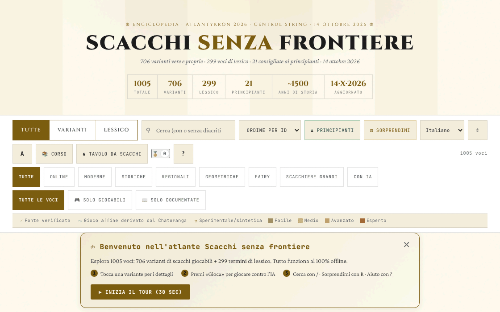

# Șah fără frontiere

[English](README.md) · [Română](README.ro.md) · [Français](README.fr.md) · **Italiano** · [Español](README.es.md) · [Português](README.pt.md) · [Deutsch](README.de.md) · [Magyar](README.hu.md)

**Versione:** 14.6.14 · **Ultimo aggiornamento:** 2026-10-26

Lingue dell'interfaccia: **Română, English, Français, Italiano, Español, Português (PT), Deutsch, Magyar**

Atlante/enciclopedia di varianti degli scacchi: 706 varianti e 299 voci di lessico, con motori giocabili per una parte di esse.

**App online:** https://chiuta.github.io/Sah-fara-frontiere/

## Che cos'è

Șah fără frontiere («Scacchi senza frontiere») è un atlante in un unico file HTML (v14.6.4, aggiornato il 22 ottobre 2026; il contenuto dell'atlante è datato 14 ottobre 2026; realizzato per il laboratorio Atlantykron 2026) con 1005 voci: 706 varianti di scacchi (online, moderne, storiche, regionali, geometriche, eterodosse, su scacchiere grandi, con IA) e 299 termini di lessico (storia, IA, giocatori, aperture). Secondo la sezione «Informazioni su questo atlante», il file è generato da uno script Python e da un JSON di dati, senza dipendenze a runtime, con implementazione in iterazioni assistite dall'IA.

## Funzionalità

- Ricerca e filtri: Tutte / Varianti / Lessico; categorie (Online, Moderne, Storiche, Regionali, Geometriche, Eterodosse, Scacchiere grandi, Con IA); «Tutte le voci», «Solo giocabili», «Solo documentate»; indicatori di fonte (fonte verificata, gioco affine dal Chaturanga, sperimentale/sintetica) e livelli di difficoltà.
- Raccolte curate: «Variante di oggi» (scelta in modo deterministico), «Essenziali», «Esotiche», «Nuove geometrie».
- Pulsanti «Principianti» e «Sorprendimi» (variante casuale).
- Una scheda per ogni voce, con «▶ Gioca» per le varianti dotate di motore: scacchiera interattiva, «Regole: ON», «IA» e «IA contro IA», «Annulla», «Reimposta», «Passo», «Ruota», suono, notazione (CJK / WXF), schermo intero, esportazione «PGN» e «FEN»; classifica ELO locale.
- «Corso»: un percorso guidato di 7 giorni e 17 traguardi (badge) da sbloccare.
- «Esporta CSV (tutte le voci)» e «Cita come BibTeX»; pulsante «Link» per la condivisione.
- Tema scuro/chiaro, tre dimensioni del testo, zoom.
- «Backup dei progressi» (in «Informazioni su questo atlante»): esporta e importa in un file JSON il percorso, i badge, l'ELO e le preferenze locali (le chiavi `sah-fara-frontiere.`); all'importazione il file viene convalidato e viene richiesta una conferma.

## Nuove funzionalità (14.4.0) — «Tavolo da scacchi»

Si aprono dal pulsante «Tavolo da scacchi» accanto a «Corso», in una finestra a cinque schede. **Ambito:** tutte le nuove funzionalità riguardano gli **scacchi standard** (regole FIDE, motore proprio, convalidato tramite perft); le 706 varianti dell'atlante non sono coperte (mantengono invariata la loro modalità «▶ Gioca»).

- **Partita in due tramite FFF.p2p** — due persone, WebRTC direttamente tra browser, **senza server**: si scambiano manualmente due codici (copia/incolla o codice QR), poi la partita procede in «lockstep»: l'host (il Bianco) convalida e numera ogni mossa, l'ospite (il Nero) la applica dopo l'eco dell'host; in caso di divergenza viene reinviato lo stato completo. Patta e nuova partita su offerta con accettazione/rifiuto, abbandono, esportazione PGN, invio della partita all'analizzatore. **Limiti:** nessun orologio da scacchi; nessun annullamento di mossa; nessuna chat; la partita non riprende dopo il ricaricamento della pagina; gli avversari vedono reciprocamente l'indirizzo IP; i NAT simmetrici (reti mobili/aziendali) richiedono STUN/TURN, che può essere aggiunto facoltativamente (vuoto per impostazione predefinita) — in tal caso l'IP pubblico arriva a quel server.
- **Analizzatore locale** — «Analizza la posizione» (valutazione in pedoni, mossa migliore, classifica delle prime mosse, matto forzato annunciato esplicitamente quando trovato) e «Analizza la partita» (segnala le mosse molto più deboli della migliore). Puoi caricare/esportare FEN e PGN. Ricerca alfa-beta a profondità fissa (deterministica, non dipende dall'orologio); **non** è un motore da torneo (non è Stockfish) e la valutazione è approssimativa.
- **Sfida del giorno** — un problema di «matto forzato in 1 o 2 mosse» generato **in modo deterministico dalla data** (lo stesso per tutti nello stesso giorno, senza rete); il motore verifica che esista una sola prima mossa vincente. Mossa sbagliata: messaggio con il motivo e, nel matto in 2, la difesa dell'avversario. Serie di giorni risolti (locale). Se la generazione non trova una posizione, l'applicazione usa un problema fisso di riserva e lo dichiara.
- **«Perché non posso muovere?»** — tocchi un pezzo o una casa e l'applicazione spiega a parole: casa vuota, pezzo dell'avversario, geometria del pezzo, percorso bloccato, il proprio re resterebbe sotto scacco, arrocco non consentito (re mosso, torre mossa, casa attaccata, pezzi in mezzo), presa en passant, promozione ecc.; pulsante e tasto `W`.
- **Tastiera e annunci audio** — scacchiera con 64 pulsanti etichettati, frecce + Invio, campo di comando (SAN o coordinate, ad es. `Nf3`, `e2e4`), tasti `L` (ultima mossa), `S` (stato), `M` (pezzi che possono muovere), `W` (perché non posso muovere); annunci in una regione `aria-live` e, facoltativamente, voce (Web Speech, se il browser dispone di una voce; altrimenti lo dichiara esplicitamente).
- **Torneo Elo locale** — Io, IA facile/media/avanzata e altre persone alla stessa scacchiera, girone all'italiana; gli incontri si giocano sulla scacchiera o si simulano IA–IA; classifica Elo ricalcolata dai risultati, esportazione JSON/CSV e importazione. La scala Elo è **interna** al torneo, non confrontabile con la FIDE. Nella simulazione IA–IA il livello avanzato usa profondità 3 (non 5), le prime 4 semimosse sono casuali a partire dal seme dell'incontro, e la partita si ferma a 200 semimosse (patta) — dichiarato anche nell'interfaccia.

**Il motore e la sua forza.** I livelli: facile = profondità 1 con scelta tra mosse quasi equivalenti; medio = profondità 2; avanzato = profondità 5 con budget di nodi. In incontri di controllo (3 aperture casuali × 2 colori, 160 semimosse): il facile ha vinto 12–0 contro mosse casuali, l'avanzato ha vinto 6–0 contro il medio e 6–0 contro il facile. Campioni piccoli: indicano l'ordine, non una forza misurabile in Elo. La patta per triplice ripetizione, la regola delle 50 mosse e il materiale insufficiente si applicano automaticamente. Nessun orologio.

**Lingue.** L'interfaccia, le finestre del kit FFF e il Tavolo da scacchi seguono la lingua della pagina e sono disponibili in rumeno, inglese, francese, italiano, spagnolo, portoghese, ungherese e tedesco; il selettore nella barra dei controlli (o quello nella scheda Accessibilità del tavolo) cambia la lingua dell'intera pagina. Il contenuto dell'atlante è tradotto così: il testo delle regole e il sottotitolo di tutte le 1005 voci (706 varianti + 299 voci di lessico) esistono in tutte e 8 le lingue, come il corso, la sezione «Informazioni su questo atlante», la meta description e circa 430 etichette generiche. **Restano in rumeno:** circa 4000 etichette uniche (frasi isolate, ad es. «960 posizioni»), alcune etichette che sono nomi o termini inglesi (Lichess, Streaming, …) e, naturalmente, i nomi propri (giocatori, motori, prodotti, organizzazioni, aperture) e gli acronimi (FIDE, NNUE…). **Le traduzioni diverse dal rumeno e dall'inglese sono automatiche e non verificate da madrelingua.**

Test: `node tests/fff-r8.test.mjs` (Playwright, rete bloccata, 2 pagine per il P2P, axe, 1280×800 e 360×740) e `node tests/engine.test.mjs` (il motore in Node: perft, FEN, SAN, patte, matto in N, spiegazioni).

## Guida all'uso

1. Usa il campo di ricerca e i filtri (Tutte, Varianti, Lessico, categorie) per trovare una voce; fai clic su una scheda per aprirla.
2. Nella scheda leggi le regole; se c'è un motore, premi «▶ Gioca».
3. Scorciatoie da tastiera (dalla finestra «?»): `/` attiva la ricerca; `R` variante casuale; `B` varianti per principianti; `T` cambia il tema; `A` cambia la dimensione del testo; `C` apre il percorso guidato; `?` aiuto; `Esc` chiude le finestre; `Invio` o `Spazio` apre la scheda selezionata; `Tab` / `Maiusc+Tab` navigazione.
4. «📚 Corso» apre il percorso di 7 giorni; i progressi vengono salvati localmente e «Azzera i progressi» li cancella.
5. In partita puoi esportare la posizione o la partita con «PGN» / «FEN».
6. «Informazioni su questo atlante →» contiene informazioni sull'atlante, la versione e l'autore; da lì si possono esportare le voci in CSV o BibTeX.

## Privacy e rete

- Locale: in `localStorage`, con il prefisso `sah-fara-frontiere.` — lo stato dell'atlante (`sah-fara-frontiere.state:v2`), il percorso (`sah-fara-frontiere.curriculum:v1`), il tema, la dimensione del testo, il suono, lo stile di notazione e dei glifi, i badge, le statistiche di gioco, l'ELO del giocatore, lo stato della partita in corso e gli indicatori «benvenuto»/tour visto.
- Le funzionalità del «Tavolo da scacchi» usano chiavi separate `sff_r8_` (preferenze di annunci/voce, torneo, serie giornaliera, cache del problema del giorno); il kit FFF aggiunge il backup (esportazione/importazione/cancellazione) e la finestra «Trasparenza» dal numero di versione.
- L'unica nuova comunicazione di rete è la partita in due facoltativa, tramite WebRTC direttamente tra i due giocatori, con segnalazione manuale e, solo se ne inserisci uno, un server STUN (egress dichiarato: 0).
- Rete: nel codice verificato non ci sono chiamate `fetch` né script/font caricati da host esterni. Le schede contengono link a fonti (ad esempio Wikipedia, FIDE Handbook, Lichess, chessvariants.com), che si aprono solo se li clicchi. Il testo dell'applicazione afferma: «Funziona offline, senza tracciamento, senza pubblicità».
- Il motore IA gira localmente nel browser.

## Esecuzione locale / offline

Scarica `index.html` (circa 2,4 MB) e aprilo in un browser; funziona senza internet. Solo i link verso fonti esterne richiedono una connessione.

## Cronologia / Changelog
### 14.6.13 — 2026-10-23

- Bersagli touch di almeno 44 px sui dispositivi touch (`pointer:coarse`); il desktop resta invariato.

### 14.6.12 — 2026-10-23

- Le chiavi dell'archiviazione locale usano ora il prefisso `sah-fara-frontiere.` (`FFF.store.migrate` all'avvio, prima di qualsiasi lettura): i dati esistenti vengono conservati automaticamente e i vecchi backup `.fff.json` si possono ancora importare.

- **14.6.10 — 2026-10-22:** Peso e DOM: la pagina scende da 8,4 MB a 3,2 MB e da circa 22.500 a circa 1.700 nodi DOM all’avvio. Le 1.005 schede vengono create come semplici scheletri (aria-label, tabindex) e il loro contenuto è costruito solo quando si avvicinano alla finestra (IntersectionObserver, margine di 1.400 px) e liberato quando si allontanano, mantenendo l’altezza misurata perché lo scorrimento non salti; l’evidenziazione della ricerca si applica all’idratazione. Le traduzioni del contenuto (en, fr, it, es, pt, de, hu; 5,3 MB) sono in `i18n/vi18n-<lingua>.js`, caricati solo per la lingua scelta (più l’inglese come riserva); il service worker li tiene in cache e, quando la pagina è inattiva, scarica il resto in background (non con Save-Data / connessioni lente), quindi l’app resta completamente offline; se un pacchetto non si può caricare viene mostrato un avviso nella lingua scelta. Bersagli touch di 44 px su puntatore grossolano per i pulsanti di traguardi, informazioni, banner di benvenuto e aiuto. Nuovo test: `tests/lazy.test.mjs`.

### 14.6.9 — 2026-10-22

fff-kit 1.1.4: target touch e dimensione minima del testo; target touch e testo corretti.

- 14.6.8 — 2026-10-22: fff-kit 1.1.2: PBKDF2 con 600.000 iterazioni, protezione anti-clickjacking
- 14.6.7 — 2026-10-22: conferme e alternative di copia usano finestre inline tradotte al posto di confirm()/prompt(); service worker e manifest reali per l’avvio offline; rifiniture per mobile e accessibilità: testo di almeno 12 px e aree tattili di almeno 24 px.
- **14.6.6 — 2026-10-22:** i suggerimenti e le etichette di accessibilità dei badge «variante sperimentale» e «gioco affine» sono ora tradotti in tutte le lingue (erano rimasti in rumeno).
### 14.6.5 — 2026-10-22
- Correzioni di traduzione: il titolo della pagina e i meta tag seguono la lingua dell’interfaccia; le etichette dei pulsanti di filtro per tag e dei tipi di scacchiera sono tradotte nelle 8 lingue.

### v14.6.4 — 22 ottobre 2026
- Corretta la voce 460 (Armenia): i tre titoli olimpici (2006, 2008, 2012) non furono consecutivi (nel 2010 vinse l'Ucraina) e Aronian era secondo, non terzo, al mondo nel 2014; la formula «tripletta» è stata rimossa in tutte e 8 le lingue. Verificate le 26 voci segnalate; nessun altro errore trovato.

### v14.6.3 — 21 ottobre 2026
- Verificate e corrette 26 voci dell'atlante (ad es. l'Olimpiade non ufficiale di Monaco 1936, la biografia di Steinitz, il numero di federazioni); sei concetti di scacchi eterodossi non attestati riportano ora la nota «concetto non attestato». Altre circa 2.700 etichette tradotte nelle 7 lingue non rumene (3.183 righe in totale); nomi propri, anni e sigle restano invariati.

### v14.6.2 — 19 ottobre 2026
- Il «Tavolo da scacchi» e le sue funzionalità (partita in due, analizzatore, sfida del giorno, «perché non posso muovere?», gioco da tastiera e audio, torneo Elo locale) sono presenti nella versione attuale: lo script era stato rimosso per errore in una pulizia precedente ed è stato ripristinato (14.6.0) con lo stesso comportamento; i test sono stati aggiornati. I testi del tavolo seguono ora la lingua della pagina (la preferenza di lingua separata è stata rimossa).
- Contenuto dell'atlante tradotto in 8 lingue: testo delle regole e sottotitolo delle 1005 voci, corso, «Informazioni su questo atlante», meta description e circa 430 etichette generiche; corretto: il titolo «ȘAH» era tradotto per errore con «scacco» (la mossa) invece di «scacchi» (il gioco).

### v14.4.0 — 14 ottobre 2026 (turno 8, C1a)
- «Tavolo da scacchi» per gli scacchi standard: partita in due P2P (senza server), analizzatore locale, sfida del giorno determinata dalla data, «perché non posso muovere?», gioco da tastiera con annunci audio, torneo Elo locale; 8 lingue per i nuovi testi.
- Kit FFF (core, label, bundle, qr, p2p, tts) con `app.json`; CSP con hash ricalcolati; backup e finestra «Trasparenza» dal numero di versione; test `tests/fff-r8.test.mjs` e `tests/engine.test.mjs`.
- L'atlante (1005 voci) e la modalità «▶ Gioca» esistente sono invariati (verificato in un test).

### v14.3.1 — 12 ottobre 2026
- La versione e la data dell'ultimo aggiornamento sono mostrate nell'app («Informazioni su questo atlante», piè di pagina); il titolo, l'intestazione, la statistica «Aggiornato» e il BibTeX mostrano v14.3.1 / 12 ottobre 2026.

### v14.3 — 11 ottobre 2026
- Su schermi stretti (≤820 px) o bassi (≤560 px) la barra dei comandi non resta più incollata in alto: su telefono occupava ≈620 px su 740 e copriva le schede (il clic sulle prime schede non le raggiungeva più); su desktop le schede hanno `scroll-margin-top` per non restare sotto la barra fissa.
- Indicatore visivo «L'IA sta pensando… N s» sotto la scacchiera mentre l'IA calcola (lo stato resta annunciato anche dalla regione `aria-live` esistente); rispetta `prefers-reduced-motion`.
- Il banner «Benvenuto» compare ora in cima al contenuto (prima di «Variante di oggi»), non sotto le sezioni curate.
- La dimensione (≈1,9 MB) resta: ~1,05 MB sono dati (già compatti) e ~230 KB di font base64 per il funzionamento offline.

### v14.2 — 11 ottobre 2026
- Sicurezza: la policy CSP non contiene più `'unsafe-inline'`, `'wasm-unsafe-eval'` e `blob:` per gli script (gli script inline sono ora autorizzati tramite hash SHA-256); `worker-src` è `'none'`.
- Esportazione/importazione dei progressi locali (badge, percorso, ELO, preferenze) da «Informazioni su questo atlante».
- Versione aggiornata a v14.2 (README, visualizzazione nell'app, BibTeX).

### v14.1 — 11 ottobre 2026
- Accessibilità: la finestra dei dettagli ha ora un titolo implicito (nome accessibile), il blocco «Sostieni» è una regione etichettata (aside); verifica axe senza violazioni.
- Rimosso il gestore onclick inline dall'avviso di browser non compatibile (sostituito con un listener).
- Data e versione aggiornate: v14.1, 11 ottobre 2026 (titolo, intestazione, statistica «Aggiornato», BibTeX).

## Licenza

MIT — vedi il file `LICENSE`. L'intestazione di `index.html` e il testo dell'interfaccia indicano la stessa licenza (una precedente menzione «CC-BY-SA 4.0» nell'interfaccia è stata rimossa durante l'audit, 2026-10-11, per eliminare la contraddizione).

Eccezione — materiali di terzi: i riassunti e le descrizioni di alcune varianti si basano su fonti pubbliche (Wikipedia, FIDE, Lichess, chessvariants.com), indicate nell'applicazione come link e ringraziamenti. La licenza MIT copre il contributo originale dell'autore (codice, selezione, testi propri); qualsiasi testo ripreso o adattato da terzi resta sotto la licenza della fonte (ad es. CC BY-SA per Wikipedia) e deve essere verificato da chi lo riutilizza.

## Marchi

I nomi dei giochi sono denominazioni commerciali dei rispettivi titolari, usate a scopo descrittivo; il progetto non è affiliato ad essi.

## Autore

Alexio — Alexandru-Ionuț Chiuță, contatto: alexio@trom.tf. L'applicazione lo presenta come autore, sviluppatore e musicista, con menzioni del progetto TROM, di Editura Tornada e del Centrul StrING.

## Riepilogo
Șah fără frontiere è un atlante di varianti degli scacchi a file singolo: 706 varianti più 299 voci di lessico, con ricerca, filtri, motori giocabili (IA locale, esportazione PGN/FEN, ELO locale), un corso guidato di 7 giorni, badge ed esportazione CSV/BibTeX. Dalla 14.4.0 un «Tavolo da scacchi» per gli scacchi standard aggiunge il gioco in due via WebRTC (segnalazione manuale, senza server), un semplice analizzatore locale, un problema di matto quotidiano deterministico, spiegazioni «perché non posso muovere?», il gioco da tastiera con annunci vocali e un torneo Elo locale (le 706 varianti non sono coperte). Tutto gira in locale; i progressi sono conservati in localStorage (chiavi `sah-fara-frontiere.`) e nel codice non sono state trovate richieste esterne. Concesso in licenza MIT per il contributo proprio dell'autore (vedi LICENSE); i riassunti derivati da terzi mantengono le licenze d'origine.

## Audit

Audit: 2026-10-10 — verificata l'affermazione «senza rete» (0 `fetch`/XHR/WebSocket, CSP `connect-src 'self'`, solo link `<a>` esterni); corretti il contrasto del tema chiaro e la semantica delle schede (i pulsanti dei tag nelle schede non sono più annidati in un `role="button"`). La licenza è stata unificata (2026-10-11) e successivamente stabilita come MIT, ed è stato aggiunto `LICENSE`. Alcune varianti sono contrassegnate nell'applicazione come «sperimentali/sintetiche» (senza fonte primaria): considera le loro regole non verificate.
