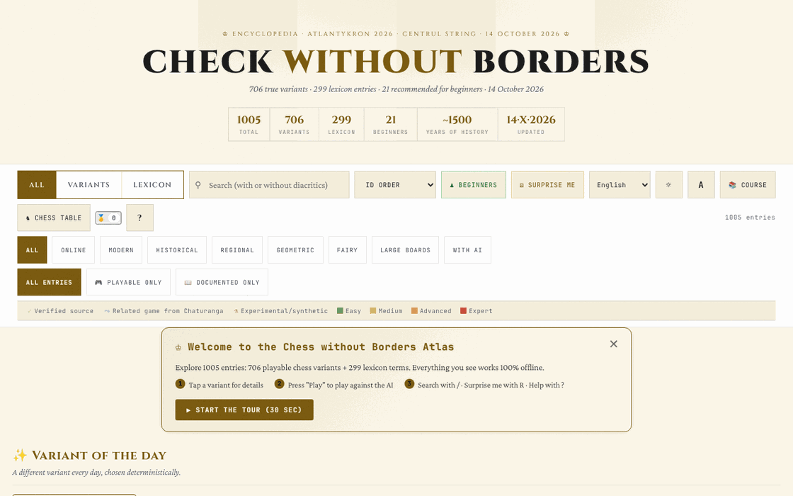

# Șah fără frontiere

**English** · [Română](README.ro.md) · [Français](README.fr.md) · [Italiano](README.it.md) · [Español](README.es.md) · [Português](README.pt.md) · [Deutsch](README.de.md) · [Magyar](README.hu.md)

**Version:** 14.6.7 · **Last updated:** 2026-10-22

Interface languages: **Română, English, Français, Italiano, Español, Português (PT), Deutsch, Magyar**

An atlas/encyclopedia of chess variants: 706 variants and 299 lexicon entries, with playable engines for some of them.

**Live app:** https://chiuta.github.io/Sah-fara-frontiere/

## What it is

Șah fără frontiere ("Chess without borders") is an atlas in a single HTML file (v14.6.4, last updated on 22 October 2026; the atlas content is dated 14 October 2026; made for the Atlantykron 2026 workshop) with 1005 entries: 706 chess variants (online, modern, historical, regional, geometric, fairy, large-board, with AI) and 299 lexicon terms (history, AI, players, openings). According to the "About this atlas" section, the file is generated from a Python script and a JSON data file, with no runtime dependencies, implemented in AI-assisted iterations.

## Features

- Search and filters: All / Variants / Lexicon; categories (Online, Modern, Historical, Regional, Geometric, Fairy, Large Boards, With AI); "All entries", "Playable only", "Documented only"; source markers (verified source, related game from Chaturanga, experimental/synthetic) and difficulty levels.
- Curated collections: "Variant of the day" (chosen deterministically), "Essentials", "Exotic", "New geometries".
- "Beginners" and "Surprise me" buttons (random variant).
- A sheet for every entry, with "▶ Play" for variants that have an engine: interactive board, "Rules: ON", "AI" and "AI vs AI", "Undo", "Reset", "Step", "Flip", sound, notation (CJK / WXF), full screen, "PGN" and "FEN" export; local ELO ranking.
- "Course": a guided 7-day path and 17 unlockable achievements (badges).
- "Export CSV (all entries)" and "Cite as BibTeX"; a "Link" button for sharing.
- Dark/light theme, three text sizes, zoom.
- "Progress backup" (in "About this atlas"): exports and imports to/from a JSON file the progress, badges, ELO and local preferences (the `sff:` keys); on import the file is validated and confirmation is requested.

## New features (14.4.0) — "Chess table"

They open from the "Chess table" button next to "Course", in a dialog with five tabs. **Scope:** all the new features concern **standard chess** (FIDE rules, own engine, validated by perft); the 706 variants in the atlas are not covered (they keep their "▶ Play" mode unchanged).

- **Two-player game via FFF.p2p** — two people, WebRTC directly between browsers, **without a server**: you manually exchange two codes (copy/paste or QR code), then the game runs in "lockstep": the host (White) validates and numbers every move, the guest (Black) applies it after the host's echo; on divergence the full state is resent. Draw and new game by offer with accept/decline, resignation, PGN export, sending the game to the analyzer. **Limits:** no chess clock; no move takeback; no chat; the game does not resume after the page is reloaded; the opponents see each other's IP address; symmetric NATs (mobile/corporate networks) require STUN/TURN, which can be added optionally (empty by default) — in that case the public IP reaches that server.
- **Local analyzer** — "Analyze position" (evaluation in pawns, best move, ranking of the top moves, forced mate announced explicitly when found) and "Analyze game" (marks the moves much weaker than the best one). You can load/export FEN and PGN. Fixed-depth alpha-beta search (deterministic, independent of the clock); it is **not** a tournament engine (it is not Stockfish) and the evaluation is approximate.
- **Challenge of the day** — a "forced mate in 1 or 2" problem generated **deterministically from the date** (the same for everyone on the same day, without network); the engine checks that there is exactly one winning first move. Wrong move: a message with the reason and, for mate in 2, the opponent's defence. Streak of solved days (local). If generation finds no position, the application uses a fixed fallback problem and says so.
- **"Why can't I move?"** — you touch a piece or a square and the application explains in words: empty square, opponent's piece, piece geometry, blocked path, own king would remain in check, castling not allowed (king moved, rook moved, attacked square, pieces in between), en passant, promotion, etc.; button and the `W` key.
- **Keyboard and audio announcements** — a board with 64 labelled buttons, arrows + Enter, a command field (SAN or coordinates, e.g. `Nf3`, `e2e4`), the keys `L` (last move), `S` (status), `M` (pieces that can move), `W` (why can't I move); announcements in an `aria-live` region and, optionally, voice (Web Speech, if the browser has a voice; otherwise it says explicitly that there is none).
- **Local Elo tournament** — Me, easy/medium/advanced AI and other people at the same board, round-robin; matches are played on the board or simulated AI–AI; Elo ranking recomputed from the results, JSON/CSV export and import. The Elo scale is **internal** to the tournament, not comparable with FIDE. In the AI–AI simulation the advanced level uses depth 3 (not 5), the first 4 half-moves are random from the match seed, and the game stops at 200 half-moves (draw) — also stated in the interface.

**The engine and its strength.** The levels: easy = depth 1 with a choice among nearly equal moves; medium = depth 2; advanced = depth 5 with a node budget. In control matches (3 random openings × 2 colours, 160 half-moves): easy won 12–0 against random moves, advanced won 6–0 against medium and 6–0 against easy. Small samples: they indicate the order, not a measurable strength in Elo. Draw by threefold repetition, the 50-move rule and insufficient material are applied automatically. No clock.

**Languages.** The interface, the dialogs of the FFF kit and the Chess table follow the page language and are available in Romanian, English, French, Italian, Spanish, Portuguese, Hungarian and German; the selector in the controls bar (or the one in the table's Accessibility tab) switches the whole page. The atlas content is translated as follows: the rules text and the subtitle of all 1005 entries (706 variants + 299 lexicon entries) exist in all 8 languages, as do the course, the "About this atlas" section, the meta description and about 430 generic tags. **Still in Romanian:** about 4000 one-off tags (unique phrases, e.g. "960 positions"), some tags that are English names or terms (Lichess, Streaming, …) and, naturally, proper names (players, engines, products, organisations, openings) and acronyms (FIDE, NNUE…). **The translations other than Romanian and English are automatic and not verified by native speakers.**

Tests: `node tests/fff-r8.test.mjs` (Playwright, network blocked, 2 pages for P2P, axe, 1280×800 and 360×740) and `node tests/engine.test.mjs` (the engine in Node: perft, FEN, SAN, draws, mate in N, explanations).

## User guide

1. Use the search field and the filters (All, Variants, Lexicon, categories) to find an entry; click a card to open it.
2. In the sheet read the rules; if there is an engine, press "▶ Play".
3. Keyboard shortcuts (from the "?" window): `/` focuses the search; `R` random variant; `B` variants for beginners; `T` switches the theme; `A` switches the text size; `C` opens the guided path; `?` help; `Esc` closes the windows; `Enter` or `Space` opens the focused card; `Tab` / `Shift+Tab` navigation.
4. "📚 Course" opens the 7-day path; progress is saved locally, and "Reset progress" deletes it.
5. During a game you can export the position or the game with "PGN" / "FEN".
6. "About this atlas →" contains information about the atlas, version and author; from there the entries can be exported to CSV or BibTeX.

## Privacy and network

- Local: in `localStorage`, with the prefix `sff:` — the atlas state (`sff:state:v2`), the course (`sff:curriculum:v1`), the theme, text size, sound, notation and glyph style, the badges, game statistics, the player's ELO, the current game state and the "welcome"/seen-tour markers.
- The "Chess table" features use separate `sff_r8_` keys (announcement/voice preferences, tournament, daily streak, the cache of the problem of the day); the FFF kit adds backup (export/import/delete) and the "Transparency" window from the version number.
- The only new network communication is the optional two-player game, through WebRTC directly between the two players, with manual signalling and, only if you enter one, a STUN server (declared egress: 0).
- Network: in the checked code there are no `fetch` calls and no scripts/fonts loaded from external hosts. The sheets contain links to sources (for example Wikipedia, FIDE Handbook, Lichess, chessvariants.com), which open only if you click them. The application text states: "Works offline, no tracking, no ads".
- The AI engine runs locally in the browser.

## Running locally / offline

Download `index.html` (about 2.4 MB) and open it in a browser; it works without internet. Only the links to external sources require a connection.

## History / Changelog

- 14.6.7 — 2026-10-22: confirmations and copy fallbacks now use translated inline dialogs instead of confirm()/prompt(); real service worker and manifest for offline start; mobile and accessibility polish: text at least 12 px and touch targets at least 24 px.
- **14.6.6 — 2026-10-22:** the tooltips and accessibility labels of the "experimental variant" and "related game" badges are now translated into all languages (they were left in Romanian).
### 14.6.5 — 2026-10-22
- Translation fixes: page title and meta tags follow the interface language; tag-filter button labels and board/type labels are translated in all 8 languages.

### v14.6.4 — 22 October 2026
- Corrected entry 460 (Armenia): the three Olympiad titles (2006, 2008, 2012) were not consecutive (Ukraine won in 2010) and Aronian was second, not third, in the world in 2014; the "hat-trick" wording was removed in all 8 languages. Fact-checked the 26 entries flagged for review; no further errors found.

### v14.6.3 — 21 October 2026
- Fact-checked and corrected 26 atlas entries (e.g. the unofficial 1936 Munich Olympiad, Steinitz's biography, the federation count); six unattested fairy-chess concepts now carry a "concept not attested" note. About 2,700 more labels translated into the 7 non-Romanian languages (3,183 rows in total); proper names, years and acronyms stay unchanged.

### v14.6.2 — 19 October 2026
- The "Chess table" and its features (two-player game, analyzer, challenge of the day, "why can't I move?", keyboard and audio play, local Elo tournament) are present in the current version: the script had been removed by mistake in an earlier cleanup and was restored (14.6.0) with the same behaviour; the tests were updated. The table's texts now follow the page language (the separate language preference was removed).
- Atlas content translated into 8 languages: rules text and subtitle of all 1005 entries, the course, "About this atlas", the meta description and about 430 generic tags; fixed: the title "ȘAH" was wrongly translated as "check" (the chess move) in some languages.

### v14.4.0 — 14 October 2026 (round 8, C1a)
- "Chess table" for standard chess: two-player P2P game (no server), local analyzer, date-determined challenge of the day, "why can't I move?", keyboard play with audio announcements, local Elo tournament; 8 languages for the new texts.
- FFF kit (core, label, bundle, qr, p2p, tts) with `app.json`; CSP with recomputed hashes; backup and the "Transparency" window from the version number; tests `tests/fff-r8.test.mjs` and `tests/engine.test.mjs`.
- The atlas (1005 entries) and the existing "▶ Play" mode are unchanged (verified in a test).

### v14.3.1 — 12 October 2026
- The version and the last-updated date are shown in the app ("About this atlas", footer); the title, header, the "Updated" statistic and BibTeX show v14.3.1 / 12 October 2026.

### v14.3 — 11 October 2026
- On narrow (≤820 px) or short (≤560 px) screens the command bar no longer stays stuck at the top: on a phone it took ≈620 px out of 740 and covered the cards (clicking the first cards no longer reached them); on desktop, the cards have `scroll-margin-top` so they do not stay under the sticky bar.
- A visual "AI is thinking… N s" indicator under the board while the AI computes (the state is still announced through the existing `aria-live` region); it respects `prefers-reduced-motion`.
- The "Welcome" banner now appears at the top of the content (before "Variant of the day"), not under the curated sections.
- The size (≈1.9 MB) remains: ~1.05 MB is data (already compact) and ~230 KB base64 fonts for offline operation.

### v14.2 — 11 October 2026
- Security: the CSP policy no longer contains `'unsafe-inline'`, `'wasm-unsafe-eval'` and `blob:` for scripts (inline scripts are now authorized by SHA-256 hash); `worker-src` is `'none'`.
- Export/import of local progress (badges, course, ELO, preferences) from "About this atlas".
- Version updated to v14.2 (README, in-app display, BibTeX).

### v14.1 — 11 October 2026
- Accessibility: the details dialog now has an implicit title (accessible name), the "Support" block is a labelled region (aside); axe check with no violations.
- Removed the inline onclick handler from the incompatible-browser warning (replaced with a listener).
- Date and version updated: v14.1, 11 October 2026 (title, header, "Updated" statistic, BibTeX).

## License

MIT — see the `LICENSE` file. The header in `index.html` and the interface text indicate the same license (an earlier "CC-BY-SA 4.0" mention in the interface was removed during the audit, 2026-10-11, to eliminate the contradiction).

Exception — third-party material: the summaries and descriptions of some variants rely on public sources (Wikipedia, FIDE, Lichess, chessvariants.com), indicated in the application as links and acknowledgements. The MIT license covers the author's original contribution (code, selection, own texts); any text taken or adapted from third parties remains under the source's license (e.g. CC BY-SA for Wikipedia) and must be checked by whoever reuses it.

## Trademarks

Game names are trade names of their holders, used descriptively; the project is not affiliated with them.

## Author

Alexio — Alexandru-Ionuț Chiuță, contact: alexio@trom.tf. The application presents him as author, developer and musician, with mentions of the TROM project, Editura Tornada and Centrul StrING.

## English summary

Șah fără frontiere is a single-file chess-variants atlas: 706 variants plus 299 lexicon entries, with search, filters, playable engines (local AI, PGN/FEN export, local ELO), a 7-day guided course, badges and CSV/BibTeX export. Since 14.4.0 a "Chess table" for standard chess adds two-player play over WebRTC (manual signalling, no server), a simple local analyzer, a deterministic daily mate puzzle, "why can't I move?" explanations, keyboard play with spoken announcements and a local Elo tournament (the 706 variants are not covered). Everything runs locally; progress is kept in localStorage (`sff:` keys) and no external requests were found in the code. Licensed MIT for the author's own contribution (see LICENSE); third-party-derived summaries keep their source licences.

## Audit

Audit: 2026-10-10 — the "no network" claim verified (0 `fetch`/XHR/WebSocket, CSP `connect-src 'self'`, only external `<a>` links); light-theme contrast and card semantics corrected (the tag buttons in cards are no longer nested inside a `role="button"`). The license was unified (2026-10-11) and later established as MIT, and `LICENSE` was added. Some variants are marked in the application as "experimental/synthetic" (no primary source): treat their rules as unverified.
