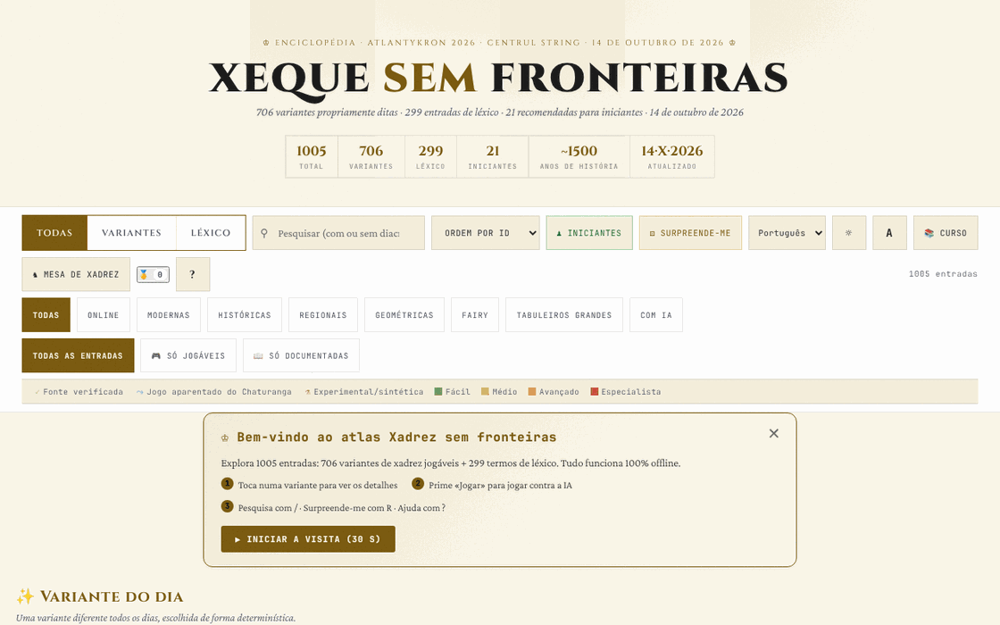

# Șah fără frontiere

[English](README.md) · [Română](README.ro.md) · [Français](README.fr.md) · [Italiano](README.it.md) · [Español](README.es.md) · **Português** · [Deutsch](README.de.md) · [Magyar](README.hu.md)

**Versão:** 15.1.0 · **Última atualização:** 2026-10-27

Idiomas da interface: **Română, English, Français, Italiano, Español, Português (PT), Deutsch, Magyar**

Atlas/enciclopédia de variantes de xadrez: 706 variantes e 299 entradas de léxico, com motores jogáveis para uma parte delas.

**Aplicação online:** https://chiuta.github.io/Sah-fara-frontiere/

## O que é

Șah fără frontiere («Xadrez sem fronteiras») é um atlas num único ficheiro HTML (v14.6.4, atualizado a 22 de outubro de 2026; o conteúdo do atlas está datado de 14 de outubro de 2026; realizado para o atelier Atlantykron 2026) com 1005 entradas: 706 variantes de xadrez (online, modernas, históricas, regionais, geométricas, heterodoxas, em tabuleiros grandes, com IA) e 299 termos de léxico (história, IA, jogadores, aberturas). De acordo com a secção «Acerca deste atlas», o ficheiro é gerado a partir de um script Python e de um JSON de dados, sem dependências em tempo de execução, com implementação em iterações assistidas por IA.

## Funcionalidades

- Pesquisa e filtros: Todas / Variantes / Léxico; categorias (Online, Modernas, Históricas, Regionais, Geométricas, Heterodoxas, Tabuleiros grandes, Com IA); «Todas as entradas», «Apenas jogáveis», «Apenas documentadas»; marcas de fonte (fonte verificada, jogo aparentado do Chaturanga, experimental/sintética) e níveis de dificuldade.
- Coleções selecionadas: «Variante de hoje» (escolhida de forma determinista), «Essenciais», «Exóticas», «Novas geometrias».
- Botões «Principiantes» e «Surpreenda-me» (variante aleatória).
- Uma ficha para cada entrada, com «▶ Jogar» para as variantes com motor: tabuleiro interativo, «Regras: ON», «IA» e «IA contra IA», «Anular», «Repor», «Passo», «Rodar», som, notação (CJK / WXF), ecrã inteiro, exportação «PGN» e «FEN»; classificação ELO local.
- «Curso»: um percurso guiado de 7 dias e 17 conquistas (emblemas) desbloqueáveis.
- «Exportar CSV (todas as entradas)» e «Citar como BibTeX»; botão «Ligação» para partilha.
- Tema escuro/claro, três tamanhos de texto, zoom.
- «Cópia de segurança do progresso» (em «Acerca deste atlas»): exporta e importa num ficheiro JSON o percurso, os emblemas, o ELO e as preferências locais (as chaves `sah-fara-frontiere.`); na importação o ficheiro é validado e é pedida confirmação.

## Novas funcionalidades (14.4.0) — «Mesa de xadrez»

Abrem-se a partir do botão «Mesa de xadrez» junto a «Curso», numa caixa de diálogo com cinco separadores. **Âmbito:** todas as novas funcionalidades dizem respeito ao **xadrez padrão** (regras FIDE, motor próprio, validado por perft); as 706 variantes do atlas não estão abrangidas (mantêm inalterado o seu modo «▶ Jogar»).

- **Jogo a dois através de FFF.p2p** — duas pessoas, WebRTC diretamente entre navegadores, **sem servidor**: trocam-se manualmente dois códigos (copiar/colar ou código QR) e depois o jogo decorre em «lockstep»: o anfitrião (as brancas) valida e numera cada lance, o convidado (as pretas) aplica-o após o eco do anfitrião; em caso de divergência, o estado completo é reenviado. Empate e novo jogo por oferta com aceitação/recusa, desistência, exportação PGN, envio da partida para o analisador. **Limites:** sem relógio de xadrez; sem anulação de lance; sem chat; a partida não é retomada após recarregar a página; os adversários veem mutuamente o endereço IP; os NAT simétricos (redes móveis/empresariais) exigem STUN/TURN, que pode ser acrescentado opcionalmente (vazio por predefinição) — nesse caso o IP público chega a esse servidor.
- **Analisador local** — «Analisar a posição» (avaliação em peões, melhor lance, classificação dos primeiros lances, mate forçado anunciado explicitamente quando encontrado) e «Analisar a partida» (assinala os lances muito mais fracos do que o melhor). Pode carregar/exportar FEN e PGN. Pesquisa alfa-beta de profundidade fixa (determinista, não depende do relógio); **não** é um motor de torneio (não é o Stockfish) e a avaliação é aproximada.
- **Desafio do dia** — um problema de «mate forçado em 1 ou 2» gerado **de forma determinista a partir da data** (o mesmo para todos no mesmo dia, sem rede); o motor verifica que existe um único primeiro lance vencedor. Lance errado: mensagem com o motivo e, no mate em 2, a defesa do adversário. Sequência de dias resolvidos (local). Se a geração não encontrar uma posição, a aplicação usa um problema fixo de reserva e di-lo.
- **«Porque não posso mover?»** — toca numa peça ou numa casa e a aplicação explica por palavras: casa vazia, peça do adversário, geometria da peça, caminho bloqueado, o próprio rei ficaria em xeque, roque não permitido (rei movido, torre movida, casa atacada, peças pelo meio), captura en passant, promoção, etc.; botão e tecla `W`.
- **Teclado e anúncios de áudio** — tabuleiro com 64 botões etiquetados, setas + Enter, campo de comando (SAN ou coordenadas, p. ex. `Nf3`, `e2e4`), teclas `L` (último lance), `S` (estado), `M` (peças que podem mover), `W` (porque não posso mover); anúncios numa região `aria-live` e, opcionalmente, voz (Web Speech, se o navegador tiver uma voz; caso contrário di-lo explicitamente).
- **Torneio Elo local** — Eu, IA fácil/média/avançada e outras pessoas no mesmo tabuleiro, todos contra todos; os encontros jogam-se no tabuleiro ou simulam-se IA–IA; classificação Elo recalculada a partir dos resultados, exportação JSON/CSV e importação. A escala Elo é **interna** ao torneio, não comparável com a FIDE. Na simulação IA–IA o nível avançado usa profundidade 3 (não 5), os primeiros 4 meios-lances são aleatórios a partir da semente do encontro, e a partida pára aos 200 meios-lances (empate) — também indicado na interface.

**O motor e a sua força.** Os níveis: fácil = profundidade 1 com escolha entre lances quase iguais; médio = profundidade 2; avançado = profundidade 5 com orçamento de nós. Em encontros de controlo (3 aberturas aleatórias × 2 cores, 160 meios-lances): o fácil ganhou 12–0 contra lances aleatórios, o avançado ganhou 6–0 contra o médio e 6–0 contra o fácil. Amostras pequenas: indicam a ordem, não uma força mensurável em Elo. O empate por tripla repetição, a regra dos 50 lances e o material insuficiente aplicam-se automaticamente. Sem relógio.

**Línguas.** A interface, as caixas de diálogo do kit FFF e a Mesa de xadrez seguem a língua da página e estão disponíveis em romeno, inglês, francês, italiano, espanhol, português, húngaro e alemão; o seletor na barra de controlos (ou o do separador Acessibilidade da mesa) altera a língua de toda a página. O conteúdo do atlas está traduzido assim: o texto das regras e o subtítulo das 1005 entradas (706 variantes + 299 entradas de léxico) existem nas 8 línguas, tal como o curso, a secção «Acerca deste atlas», a meta descrição e cerca de 430 etiquetas genéricas. **Continuam em romeno:** cerca de 4000 etiquetas únicas (frases isoladas, p. ex. «960 posições»), algumas etiquetas que são nomes ou termos ingleses (Lichess, Streaming, …) e, naturalmente, os nomes próprios (jogadores, motores, produtos, organizações, aberturas) e as siglas (FIDE, NNUE…). **As traduções que não sejam romeno e inglês são automáticas e não verificadas por falantes nativos.**

Testes: `node tests/fff-r8.test.mjs` (Playwright, rede bloqueada, 2 páginas para P2P, axe, 1280×800 e 360×740) e `node tests/engine.test.mjs` (o motor em Node: perft, FEN, SAN, empates, mate em N, explicações).

## Manual de utilização

1. Use o campo de pesquisa e os filtros (Todas, Variantes, Léxico, categorias) para encontrar uma entrada; clique num cartão para o abrir.
2. Na ficha leia as regras; se existir motor, prima «▶ Jogar».
3. Atalhos de teclado (a partir da janela «?»): `/` foca a pesquisa; `R` variante aleatória; `B` variantes para principiantes; `T` muda o tema; `A` muda o tamanho do texto; `C` abre o percurso guiado; `?` ajuda; `Esc` fecha as janelas; `Enter` ou `Espaço` abre o cartão focado; `Tab` / `Shift+Tab` navegação.
4. «📚 Curso» abre o percurso de 7 dias; o progresso é guardado localmente e «Repor progresso» apaga-o.
5. Durante a partida pode exportar a posição ou a partida com «PGN» / «FEN».
6. «Acerca deste atlas →» contém informações sobre o atlas, a versão e o autor; a partir daí podem exportar-se as entradas para CSV ou BibTeX.

## Privacidade e rede

- Local: em `localStorage`, com o prefixo `sah-fara-frontiere.` — o estado do atlas (`sah-fara-frontiere.state:v2`), o percurso (`sah-fara-frontiere.curriculum:v1`), o tema, o tamanho do texto, o som, o estilo de notação e de glifos, os emblemas, as estatísticas de jogo, o ELO do jogador, o estado do jogo em curso e as marcas de «boas-vindas»/visita vista.
- As funcionalidades da «Mesa de xadrez» usam chaves distintas `sff_r8_` (preferências de anúncios/voz, torneio, sequência diária, cache do problema do dia); o kit FFF acrescenta cópia de segurança (exportar/importar/apagar) e a janela «Transparência» a partir do número da versão.
- A única nova comunicação de rede é o jogo a dois opcional, através de WebRTC diretamente entre os dois jogadores, com sinalização manual e, apenas se introduzir um, um servidor STUN (egress declarado: 0).
- Rede: no código verificado não há chamadas `fetch` nem scripts/tipos de letra carregados de anfitriões externos. As fichas contêm ligações para fontes (por exemplo Wikipédia, FIDE Handbook, Lichess, chessvariants.com), que só se abrem se clicar nelas. O texto da aplicação afirma: «Funciona offline, sem rastreio, sem anúncios».
- O motor de IA corre localmente no navegador.

## Execução local / offline

Transfira `index.html` (cerca de 2,4 MB) e abra-o num navegador; funciona sem internet. Apenas as ligações para fontes externas exigem ligação.

## Histórico / Changelog
### 14.6.13 — 2026-10-23

- Alvos de toque de pelo menos 44 px em dispositivos táteis (`pointer:coarse`); o computador não muda.

### 14.6.12 — 2026-10-23

- As chaves do armazenamento local passam a usar o prefixo `sah-fara-frontiere.` (`FFF.store.migrate` no arranque, antes de qualquer leitura): os dados existentes são mantidos automaticamente e as cópias `.fff.json` antigas continuam a poder ser importadas.

- **14.6.10 — 2026-10-22:** Peso e DOM: a página desce de 8,4 MB para 3,2 MB e de cerca de 22.500 para cerca de 1.700 nós DOM ao iniciar. As 1.005 fichas são criadas como esqueletos leves (aria-label, tabindex) e o seu conteúdo só é construído quando se aproximam da janela (IntersectionObserver, margem de 1.400 px) e libertado quando se afastam, mantendo a altura medida para o deslocamento não saltar; o realce da pesquisa aplica-se na hidratação. As traduções do conteúdo (en, fr, it, es, pt, de, hu; 5,3 MB) passaram para `i18n/vi18n-<idioma>.js`, carregados só para o idioma escolhido (mais o inglês como reserva); o service worker guarda-os em cache e, quando a página está inativa, descarrega o resto em segundo plano (não com Save-Data / ligações lentas), pelo que a aplicação continua totalmente offline; se um pacote não puder ser carregado, mostra-se um aviso no idioma escolhido. Alvos táteis de 44 px com ponteiro grosseiro nos botões de conquistas, acerca, banner de boas-vindas e ajuda. Novo teste: `tests/lazy.test.mjs`.

### 14.6.9 — 2026-10-22

fff-kit 1.1.4: alvos de toque e tamanho mínimo do texto; alvos de toque e texto corrigidos.

- 14.6.8 — 2026-10-22: fff-kit 1.1.2: PBKDF2 com 600.000 iterações, proteção anti-clickjacking
- 14.6.7 — 2026-10-22: as confirmações e alternativas de cópia usam diálogos integrados traduzidos em vez de confirm()/prompt(); service worker e manifesto reais para arranque offline; melhorias para telemóvel e acessibilidade: texto de pelo menos 12 px e áreas táteis de pelo menos 24 px.
- **14.6.6 — 2026-10-22:** as dicas e etiquetas de acessibilidade dos emblemas «variante experimental» e «jogo aparentado» estão agora traduzidas em todos os idiomas (estavam em romeno).
### 14.6.5 — 2026-10-22
- Correções de tradução: o título da página e as metaetiquetas seguem o idioma da interface; as etiquetas dos botões de filtro por etiqueta e dos tipos de tabuleiro estão traduzidas nos 8 idiomas.

### v14.6.4 — 22 de outubro de 2026
- Corrigida a entrada 460 (Arménia): os três títulos olímpicos (2006, 2008, 2012) não foram consecutivos (em 2010 ganhou a Ucrânia) e Aronian era segundo, e não terceiro, do mundo em 2014; a fórmula «tripleta» foi removida nas 8 línguas. Verificadas as 26 entradas assinaladas; não se encontraram mais erros.

### v14.6.3 — 21 de outubro de 2026
- Verificadas e corrigidas 26 entradas do atlas (p. ex. a Olimpíada não oficial de Munique 1936, a biografia de Steinitz, o número de federações); seis conceitos de xadrez heterodoxo não atestados passam a ter a nota «conceito não atestado». Cerca de 2.700 rótulos adicionais traduzidos para os 7 idiomas não romenos (3.183 linhas no total); nomes próprios, anos e siglas permanecem inalterados.

### v14.6.2 — 19 de outubro de 2026
- A «Mesa de xadrez» e as suas funcionalidades (jogo a dois, analisador, desafio do dia, «porque não posso mover?», jogo com teclado e áudio, torneio Elo local) estão presentes na versão atual: o script tinha sido removido por engano numa limpeza anterior e foi restaurado (14.6.0) com o mesmo comportamento; os testes foram atualizados. Os textos da mesa seguem agora a língua da página (a preferência de língua separada foi removida).
- Conteúdo do atlas traduzido em 8 línguas: texto das regras e subtítulo das 1005 entradas, o curso, «Acerca deste atlas», a meta descrição e cerca de 430 etiquetas genéricas; corrigido: o título «ȘAH» era traduzido por engano como «xeque» (a jogada) em vez de «xadrez».

### v14.4.0 — 14 de outubro de 2026 (ronda 8, C1a)
- «Mesa de xadrez» para o xadrez padrão: jogo a dois P2P (sem servidor), analisador local, desafio do dia determinado pela data, «porque não posso mover?», jogo por teclado com anúncios de áudio, torneio Elo local; 8 línguas para os textos novos.
- Kit FFF (core, label, bundle, qr, p2p, tts) com `app.json`; CSP com hashes recalculados; cópia de segurança e janela «Transparência» a partir do número da versão; testes `tests/fff-r8.test.mjs` e `tests/engine.test.mjs`.
- O atlas (1005 entradas) e o modo «▶ Jogar» existente não se alteram (verificado em teste).

### v14.3.1 — 12 de outubro de 2026
- A versão e a data da última atualização são apresentadas na aplicação («Acerca deste atlas», rodapé); o título, o cabeçalho, a estatística «Atualizado» e o BibTeX mostram v14.3.1 / 12 de outubro de 2026.

### v14.3 — 11 de outubro de 2026
- Em ecrãs estreitos (≤820 px) ou baixos (≤560 px) a barra de comandos já não fica colada ao topo: no telemóvel ocupava ≈620 px de 740 e tapava os cartões (o clique nos primeiros cartões já não lhes chegava); em computador, os cartões têm `scroll-margin-top` para não ficarem sob a barra fixa.
- Indicador visual «A IA está a pensar… N s» por baixo do tabuleiro enquanto a IA calcula (o estado continua a ser anunciado também pela região `aria-live` existente); respeita `prefers-reduced-motion`.
- O banner «Boas-vindas» aparece agora no topo do conteúdo (antes de «Variante de hoje»), e não sob as secções selecionadas.
- O tamanho (≈1,9 MB) mantém-se: ~1,05 MB são dados (já compactos) e ~230 KB de tipos de letra em base64 para o funcionamento offline.

### v14.2 — 11 de outubro de 2026
- Segurança: a política CSP já não contém `'unsafe-inline'`, `'wasm-unsafe-eval'` nem `blob:` para scripts (os scripts em linha são agora autorizados por hash SHA-256); `worker-src` é `'none'`.
- Exportação/importação do progresso local (emblemas, percurso, ELO, preferências) a partir de «Acerca deste atlas».
- Versão atualizada para v14.2 (README, apresentação na aplicação, BibTeX).

### v14.1 — 11 de outubro de 2026
- Acessibilidade: a caixa de detalhes tem agora um título implícito (nome acessível), o bloco «Apoie» é uma região etiquetada (aside); verificação axe sem violações.
- Removido o manipulador onclick em linha do aviso de navegador incompatível (substituído por um listener).
- Data e versão atualizadas: v14.1, 11 de outubro de 2026 (título, cabeçalho, estatística «Atualizado», BibTeX).

## Licença

MIT — veja o ficheiro `LICENSE`. O cabeçalho de `index.html` e o texto da interface indicam a mesma licença (uma menção anterior de «CC-BY-SA 4.0» na interface foi removida na auditoria, 2026-10-11, para eliminar a contradição).

Exceção — materiais de terceiros: os resumos e descrições de algumas variantes apoiam-se em fontes públicas (Wikipédia, FIDE, Lichess, chessvariants.com), indicadas na aplicação como ligações e agradecimentos. A licença MIT abrange a contribuição original do autor (código, seleção, textos próprios); qualquer texto retirado ou adaptado de terceiros permanece sob a licença da fonte (p. ex. CC BY-SA para a Wikipédia) e deve ser verificado por quem o reutilize.

## Marcas

Os nomes de jogos são designações comerciais dos seus titulares, usadas de forma descritiva; o projeto não é afiliado a eles.

## Autor

Alexio — Alexandru-Ionuț Chiuță, contacto: alexio@trom.tf. A aplicação apresenta-o como autor, programador e músico, com menções do projeto TROM, da Editura Tornada e do Centrul StrING.

## Resumo
Șah fără frontiere é um atlas de variantes de xadrez num único ficheiro: 706 variantes mais 299 entradas de léxico, com pesquisa, filtros, motores jogáveis (IA local, exportação PGN/FEN, ELO local), um curso guiado de 7 dias, emblemas e exportação CSV/BibTeX. Desde a 14.4.0, uma «Mesa de xadrez» para o xadrez padrão acrescenta jogo a dois via WebRTC (sinalização manual, sem servidor), um analisador local simples, um problema de mate diário determinista, explicações «porque não posso mover?», jogo por teclado com anúncios falados e um torneio Elo local (as 706 variantes não estão abrangidas). Tudo corre localmente; o progresso é guardado em localStorage (chaves `sah-fara-frontiere.`) e não foram encontrados pedidos externos no código. Licenciado sob MIT para a contribuição própria do autor (veja LICENSE); os resumos derivados de terceiros mantêm as licenças de origem.

## Auditoria

Auditoria: 2026-10-10 — afirmação «sem rede» verificada (0 `fetch`/XHR/WebSocket, CSP `connect-src 'self'`, apenas ligações `<a>` externas); corrigidos o contraste do tema claro e a semântica dos cartões (os botões de etiqueta nos cartões já não estão aninhados num `role="button"`). A licença foi unificada (2026-10-11) e posteriormente estabelecida como MIT, e foi acrescentado `LICENSE`. Algumas variantes estão assinaladas na aplicação como «experimentais/sintéticas» (sem fonte primária): trate as suas regras como não verificadas.
