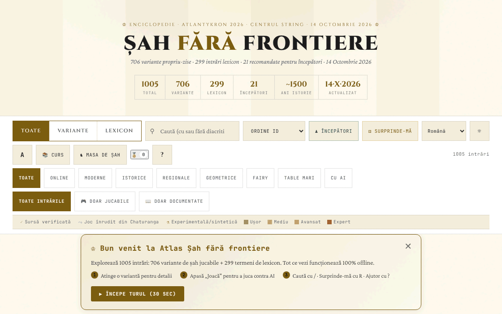

# Șah fără frontiere

[English](README.md) · **Română** · [Français](README.fr.md) · [Italiano](README.it.md) · [Español](README.es.md) · [Português](README.pt.md) · [Deutsch](README.de.md) · [Magyar](README.hu.md)

**Versiune:** 14.6.13 · **Ultima actualizare:** 2026-10-23

Limbile interfeței: **Română, English, Français, Italiano, Español, Português (PT), Deutsch, Magyar**

Atlas/enciclopedie de variante de șah: 706 variante și 299 intrări de lexicon, cu motoare jucabile pentru o parte dintre ele.

**Live:** https://chiuta.github.io/Sah-fara-frontiere/

## Ce este

Șah fără frontiere este un atlas dintr-un singur fișier HTML (v14.6.4, actualizat la 22 octombrie 2026; conținutul atlasului este datat 14 octombrie 2026; realizat pentru atelierul Atlantykron 2026) cu 1005 intrări: 706 variante de șah (online, moderne, istorice, regionale, geometrice, fairy, pe table mari, cu AI) și 299 de termeni de lexicon (istorie, AI, jucători, deschideri). Potrivit secțiunii „Despre acest atlas", fișierul este generat dintr-un script Python și un JSON de date, fără dependențe la rulare, cu implementare în iterații asistate de AI.

## Funcții

- Căutare și filtre: Toate / Variante / Lexicon; categorii (Online, Moderne, Istorice, Regionale, Geometrice, Fairy, Table Mari, Cu AI); „Toate intrările", „Doar jucabile", „Doar documentate"; marcaje de sursă (sursă verificată, joc înrudit din Chaturanga, experimentală/sintetică) și niveluri de dificultate.
- Colecții curate: „Varianta de astăzi" (aleasă determinist), „Esențiale", „Exotice", „Geometrii noi".
- Butoane „Începători" și „Surprinde-mă" (variantă aleatoare).
- Fișă pentru fiecare intrare, cu „▶ Joacă" pentru variantele cu motor: tablă interactivă, „Reguli: ON", „AI" și „AI vs AI", „Anulează", „Reset", „Pas", „Flip", sunet, notație (CJK / WXF), ecran complet, export „PGN" și „FEN"; clasament ELO local.
- „Curs": parcurs ghidat de 7 zile și 17 realizări (insigne) deblocabile.
- „Export CSV (toate intrările)" și „Citează ca BibTeX"; buton „Link" pentru partajare.
- Tema închisă/deschisă, trei mărimi de text, zoom.
- „Copie de siguranță a progresului” (în „Despre acest atlas”): exportă și importă într-un fișier JSON parcursul, insignele, ELO-ul și preferințele locale (cheile `sah-fara-frontiere.`); la import se validează fișierul și se cere confirmarea.

## Funcții noi (14.4.0) — „Masa de șah”

Se deschid din butonul „Masa de șah” de lângă „Curs”, într-un dialog cu cinci file. **Domeniu:** toate funcțiile noi se referă la **șahul standard** (reguli FIDE, motor propriu, validat prin perft); cele 706 variante din atlas nu sunt acoperite (ele își păstrează modul „▶ Joacă” neschimbat).

- **Joc în doi prin FFF.p2p** — două persoane, WebRTC direct între browsere, **fără server**: schimbi manual două coduri (copiere/lipire sau cod QR), apoi jocul rulează în „lockstep”: gazda (albele) validează și numerotează fiecare mutare, oaspetele (negrele) o aplică după ecoul gazdei; la divergență se retrimite starea completă. Remiză și joc nou prin ofertă cu accept/refuz, renunțare, export PGN, trimitere a partidei în analizor. **Limite:** fără ceas de șah; fără anulare de mutare; fără chat; partida nu se reia după reîncărcarea paginii; adversarii își văd reciproc adresa IP; NAT-urile simetrice (rețele mobile/corporative) cer STUN/TURN, care poate fi adăugat opțional (gol implicit) — atunci IP-ul public ajunge la acel server.
- **Analizor local** — „Analizează poziția” (evaluare în pioni, cea mai bună mutare, clasamentul primelor mutări, mat forțat anunțat explicit când e găsit) și „Analizează partida” (marchează mutările mult mai slabe decât cea mai bună). Poți încărca/exporta FEN și PGN. Căutare alpha-beta cu adâncime fixă (deterministă, nu depinde de ceas); **nu** este un motor de turneu (nu e Stockfish) și evaluarea e aproximativă.
- **Provocarea zilei** — o problemă „mat forțat în 1 sau 2” generată **determinist din dată** (aceeași pentru toată lumea în aceeași zi, fără rețea); motorul verifică că există o singură primă mutare câștigătoare. Mutare greșită: mesaj cu motivul și, la mat în 2, apărarea adversarului. Serie de zile rezolvate (local). Dacă generarea nu găsește o poziție, aplicația folosește o problemă fixă de rezervă și o spune.
- **„De ce nu pot muta?”** — atingi o piesă sau un pătrat și aplicația explică în cuvinte: pătrat gol, piesa adversarului, geometria piesei, drum blocat, propriul rege rămâne în șah, rocadă nepermisă (rege mutat, turn mutat, pătrat atacat, piese între ele), en passant, promovare etc.; buton și tasta `W`.
- **Tastatură și anunțuri audio** — tablă cu 64 de butoane etichetate, săgeți + Enter, câmp de comandă (SAN sau coordonate, ex. `Nf3`, `e2e4`), tastele `L` (ultima mutare), `S` (starea), `M` (piesele care pot muta), `W` (de ce nu pot muta); anunțuri în regiune `aria-live` și, opțional, voce (Web Speech, dacă browserul are o voce; altfel spune explicit că nu există).
- **Turneu Elo local** — Eu, AI ușor/mediu/avansat și alte persoane la aceeași tablă, round-robin; meciurile se joacă pe tablă sau se simulează AI–AI; clasament Elo recalculat din rezultate, export JSON/CSV și import. Scala Elo este **internă** turneului, nu comparabilă cu FIDE. În simularea AI–AI nivelul avansat folosește adâncime 3 (nu 5), primele 4 semi-mutări sunt aleatoare din sămânța meciului, iar partida se oprește la 200 de semi-mutări (remiză) — spus și în interfață.

**Motorul și puterea lui.** Nivelurile: ușor = adâncime 1 cu alegere dintre mutări aproape egale; mediu = adâncime 2; avansat = adâncime 5 cu buget de noduri. În meciuri de control (3 deschideri aleatoare × 2 culori, 160 de semi-mutări): ușor a câștigat 12–0 față de mutări aleatoare, avansat a câștigat 6–0 față de mediu și 6–0 față de ușor. Eșantioane mici: indică ordinea, nu o putere măsurabilă în Elo. Remiza prin triplă repetare, regula celor 50 de mutări și material insuficient se aplică automat. Fără ceas.

**Limbi.** Interfața, dialogurile kitului FFF și Masa de șah urmează limba paginii și sunt disponibile în română, engleză, franceză, italiană, spaniolă, portugheză, maghiară și germană; selectorul din bara de controale (sau cel din fila Accesibilitate a mesei) schimbă limba întregii pagini. Conținutul atlasului este tradus astfel: textul regulilor și subtitlul tuturor celor 1005 intrări (706 variante + 299 de intrări de lexicon) există în toate cele 8 limbi, la fel cursul, secțiunea „Despre acest atlas”, descrierea meta și circa 430 de etichete generice. **Rămân în română:** circa 4000 de etichete unice (fraze izolate, de ex. „960 poziții”), unele etichete care sunt nume sau termeni englezești (Lichess, Streaming, …) și, firesc, numele proprii (jucători, motoare, produse, organizații, deschideri) și acronimele (FIDE, NNUE…). **Traducerile în afară de română și engleză sunt automate și neverificate de vorbitori nativi.**

Teste: `node tests/fff-r8.test.mjs` (Playwright, rețea blocată, 2 pagini pentru P2P, axe, 1280×800 și 360×740) și `node tests/engine.test.mjs` (motorul în Node: perft, FEN, SAN, remize, mat în N, explicații).

## Manual de utilizare

1. Folosește câmpul de căutare și filtrele (Toate, Variante, Lexicon, categorii) pentru a găsi o intrare; apasă pe o carte pentru a o deschide.
2. În fișă citește regulile; dacă există motor, apasă „▶ Joacă".
3. Scurtături de tastatură (din fereastra „?"): `/` focalizează căutarea; `R` variantă aleatoare; `B` variante pentru începători; `T` schimbă tema; `A` schimbă mărimea textului; `C` deschide parcursul ghidat; `?` ajutor; `Esc` închide ferestrele; `Enter` sau `Space` deschide cardul focalizat; `Tab` / `Shift+Tab` navigare.
4. „📚 Curs" deschide parcursul de 7 zile; progresul se salvează local, iar „Resetează progres" îl șterge.
5. În partidă poți exporta poziția sau partida cu „PGN" / „FEN".
6. „Despre acest atlas →" conține informații despre atlas, versiune și autor; de acolo se pot exporta intrările în CSV sau BibTeX.

## Confidențialitate și rețea

- Local: în `localStorage`, cu prefixul `sah-fara-frontiere.` — starea atlasului (`sah-fara-frontiere.state:v2`), parcursul (`sah-fara-frontiere.curriculum:v1`), tema, mărimea textului, sunetul, stilul notației și glifelor, insignele, statisticile jocurilor, ELO-ul jucătorului, starea jocului curent și marcajele „bun venit"/tur văzut.
- Funcțiile din „Masa de șah” folosesc chei separate `sff_r8_` (preferințe de anunțuri/voce, turneu, serie zilnică, cache-ul problemei zilei); kitul FFF adaugă copie de siguranță (export/import/ștergere) și fereastra „Transparență” din numărul versiunii.
- Singura comunicare de rețea nouă este jocul în doi opțional, prin WebRTC direct între cei doi jucători, cu semnalizare manuală și, doar dacă introduci unul, un server STUN (egress declarat: 0).
- Rețea: în codul verificat nu există apeluri `fetch` sau scripturi/fonturi încărcate de pe gazde externe. Fișele conțin linkuri către surse (de exemplu Wikipedia, FIDE Handbook, Lichess, chessvariants.com), care se deschid doar dacă le apeși. Textul aplicației afirmă: „Funcționează offline, fără tracking, fără reclame".
- Motorul AI rulează local în browser.

## Rulare locală / offline

Descarcă `index.html` (aproximativ 2,4 MB) și deschide-l în browser; funcționează fără internet. Doar linkurile către surse externe necesită conexiune.

## Istoric / Changelog
### 14.6.13 — 2026-10-23

- Ținte tactile de cel puțin 44 px pe dispozitive tactile (`pointer:coarse`); desktopul rămâne neschimbat.

### 14.6.12 — 2026-10-23

- Cheile din stocarea locală folosesc acum prefixul `sah-fara-frontiere.` (`FFF.store.migrate` la pornire, înainte de orice citire): datele existente se păstrează automat, iar copiile `.fff.json` vechi se pot importa în continuare.

- **14.6.10 — 2026-10-22:** Greutate și DOM: pagina scade de la 8,4 MB la 3,2 MB și de la ≈22.500 la ≈1.700 de noduri DOM la pornire. Cele 1.005 carduri se creează ca „schelete” ușoare (aria-label, tabindex), iar conținutul lor se construiește doar când se apropie de fereastră (IntersectionObserver, margine 1.400 px) și se eliberează când se îndepărtează, păstrând înălțimea măsurată ca scroll-ul să nu sară; evidențierea căutării se aplică la hidratare. Traducerile conținutului (en, fr, it, es, pt, de, hu; 5,3 MB) au trecut în `i18n/vi18n-<limbă>.js`, încărcate doar pentru limba aleasă (plus engleza ca rezervă); service worker-ul le păstrează în cache și, când pagina e inactivă, descarcă restul în fundal (nu cu Save-Data / conexiuni lente), deci aplicația rămâne complet offline; dacă un pachet nu poate fi încărcat se afișează o notificare în limba aleasă. Ținte tactile de 44 px pe pointer grosier la butoanele de realizări, despre, banner de bun venit și ajutor. Test nou: `tests/lazy.test.mjs`.

### 14.6.9 — 2026-10-22

fff-kit 1.1.4: ținte tactile și text minim; ținte tactile/text corectate.

- 14.6.8 — 2026-10-22: fff-kit 1.1.2: PBKDF2 600 000 iterații, protecție anti-clickjacking
- 14.6.7 — 2026-10-22: confirmările și alternativele de copiere folosesc dialoguri inline traduse în loc de confirm()/prompt(); service worker și manifest reale pentru pornire offline; finisaje pentru mobil și accesibilitate: text de cel puțin 12 px și ținte tactile de cel puțin 24 px.
- **14.6.6 — 2026-10-22:** titlurile și etichetele de accesibilitate ale insignelor „variantă experimentală” și „joc înrudit” sunt acum traduse în toate limbile.
### 14.6.5 — 2026-10-22
- Corecturi de traducere: titlul paginii și meta-etichetele urmează limba interfeței; etichetele butoanelor de filtrare după tag și etichetele de tablă/tip sunt traduse în toate cele 8 limbi.

### v14.6.4 — 22 octombrie 2026
- Corectată intrarea 460 (Armenia): cele trei titluri olimpice (2006, 2008, 2012) nu au fost consecutive (în 2010 a câștigat Ucraina), iar Aronian a fost al doilea, nu al treilea, din lume în 2014; formularea „hat-trick” a fost eliminată în toate cele 8 limbi. Verificate factual cele 26 de intrări marcate pentru revizuire; nu s-au găsit alte erori.

### v14.6.3 — 21 octombrie 2026
- Verificate și corectate 26 de intrări din atlas (de ex. Olimpiada neoficială de la München 1936, biografia lui Steinitz, numărul de federații); șase concepte de șah feeric neatestate poartă acum nota „concept neatestat”. Încă ~2.700 de etichete traduse în cele 7 limbi non-române (3.183 de rânduri în total); numele proprii, anii și acronimele rămân neschimbate.

### v14.6.2 — 19 octombrie 2026
- „Masa de șah” și funcțiile ei (joc în doi, analizor, provocarea zilei, „de ce nu pot muta?”, joc cu tastatura și audio, turneu Elo local) sunt prezente în versiunea curentă: scriptul fusese eliminat din greșeală într-o curățare anterioară și a fost restaurat (14.6.0) cu același comportament; testele au fost actualizate. Textele mesei urmează acum limba paginii (preferința separată de limbă a fost eliminată).
- Conținutul atlasului tradus în 8 limbi: textul regulilor și subtitlul tuturor celor 1005 intrări, cursul, „Despre acest atlas”, descrierea meta și circa 430 de etichete generice; corectat: în limbile traduse titlul „ȘAH” era redat greșit prin „check” (șahul din partidă) în loc de „chess”.

### v14.4.0 — 14 octombrie 2026 (runda 8, C1a)
- „Masa de șah” pentru șahul standard: joc în doi P2P (fără server), analizor local, provocarea zilei determinată de dată, „de ce nu pot muta?”, joc de la tastatură cu anunțuri audio, turneu Elo local; 8 limbi pentru textele noi.
- Kit FFF (core, label, bundle, qr, p2p, tts) cu `app.json`; CSP cu hash-uri recalculate; copie de siguranță și fereastra „Transparență” din numărul versiunii; teste `tests/fff-r8.test.mjs` și `tests/engine.test.mjs`.
- Atlasul (1005 intrări) și modul „▶ Joacă” existent sunt neschimbate (verificat în test).

### v14.3.1 — 12 octombrie 2026
- Versiunea și data ultimei actualizări sunt afișate în aplicație („Despre acest atlas”, subsol); titlul, antetul, statistica „Actualizat” și BibTeX arată v14.3.1 / 12 octombrie 2026.

### v14.3 — 11 octombrie 2026
- Pe ecrane înguste (≤820 px) sau scurte (≤560 px) bara de comenzi nu mai rămâne lipită sus: pe telefon ocupa ≈620 px din 740 și acoperea cardurile (clicul pe primele carduri nu mai ajungea la ele); pe desktop, cardurile au `scroll-margin-top` ca să nu rămână sub bara lipită.
- Indicator vizual „AI gândește… N s” sub tablă cât timp calculează AI-ul (starea rămâne anunțată și prin regiunea `aria-live` existentă); respectă `prefers-reduced-motion`.
- Bannerul „Bun venit” apare acum în vârful conținutului (înainte de „Varianta de astăzi”), nu sub secțiunile curate.
- Dimensiunea (≈1,9 MB) rămâne: ~1,05 MB sunt datele (deja compacte) și ~230 KB fonturi base64 pentru funcționare offline.

### v14.2 — 11 octombrie 2026
- Securitate: politica CSP nu mai conține `'unsafe-inline'`, `'wasm-unsafe-eval'` și `blob:` pentru scripturi (scripturile inline sunt acum autorizate prin hash SHA-256); `worker-src` este `'none'`.
- Export/import al progresului local (insigne, parcurs, ELO, preferințe) din „Despre acest atlas”.
- Versiune actualizată la v14.2 (README, afișare în aplicație, BibTeX).

### v14.1 — 11 octombrie 2026
- Accesibilitate: dialogul de detalii are acum titlu implicit (nume accesibil), blocul „Sprijină” este regiune (aside) etichetată; verificare axe fără încălcări.
- Eliminat handlerul inline onclick din avertismentul de browser incompatibil (înlocuit cu listener).
- Date și versiune actualizate: v14.1, 11 octombrie 2026 (titlu, antet, statistică „Actualizat”, BibTeX).

## Licență

MIT — vezi fișierul `LICENSE`. Antetul din `index.html` și textul din interfață indică aceeași licență (o mențiune anterioară „CC-BY-SA 4.0” din interfață a fost eliminată la audit, 2026-10-11, pentru a elimina contradicția).

Excepție — materiale terțe: rezumatele și descrierile unor variante se sprijină pe surse publice (Wikipedia, FIDE, Lichess, chessvariants.com), indicate în aplicație ca linkuri și mulțumiri. Licența MIT acoperă contribuția originală a autorului (cod, selecție, texte proprii); orice text preluat sau adaptat de la terți rămâne sub licența sursei (de ex. CC BY-SA pentru Wikipedia) și trebuie verificat de cine îl reutilizează.

## Mărci

Numele de jocuri sunt denumiri comerciale ale deținătorilor lor, folosite descriptiv; proiectul nu este afiliat cu aceștia.

## Autor

Alexio — Alexandru-Ionuț Chiuță, contact: alexio@trom.tf. Aplicația îl prezintă ca autor, dezvoltator și muzician, cu mențiuni pentru proiectul TROM, Editura Tornada și Centrul StrING.

## Rezumat

Șah fără frontiere este un atlas al variantelor de șah într-un singur fișier: 706 variante plus 299 de intrări de lexicon, cu căutare, filtre, motoare jucabile (AI local, export PGN/FEN, ELO local), un curs ghidat de 7 zile, insigne și export CSV/BibTeX. Din 14.4.0, o „Masă de joc” pentru șahul standard adaugă joc în doi prin WebRTC (semnalizare manuală, fără server), un analizor local simplu, o problemă zilnică de mat determinist, explicații „de ce nu pot muta?”, joc cu tastatura cu anunțuri vocale și un turneu Elo local (cele 706 variante nu sunt acoperite). Totul rulează local; progresul se păstrează în localStorage (chei `sah-fara-frontiere.`) și nu s-au găsit cereri externe în cod. Licență MIT pentru contribuția proprie a autorului (vezi LICENSE); rezumatele derivate din terți își păstrează licențele sursă.

## Audit

Audit: 2026-10-10 — claimul „fără rețea” verificat (0 `fetch`/XHR/WebSocket, CSP `connect-src 'self'`, doar linkuri `<a>` externe); corectat contrastul din tema deschisă și semantica cardurilor (butoanele de tag din carduri nu mai sunt imbricate într-un `role="button"`). Licența a fost unificată (2026-10-11) și ulterior stabilită ca MIT și s-a adăugat `LICENSE`. Unele variante sunt marcate în aplicație ca „experimentale/sintetice” (fără sursă primară): tratează regulile lor ca neverificate.
